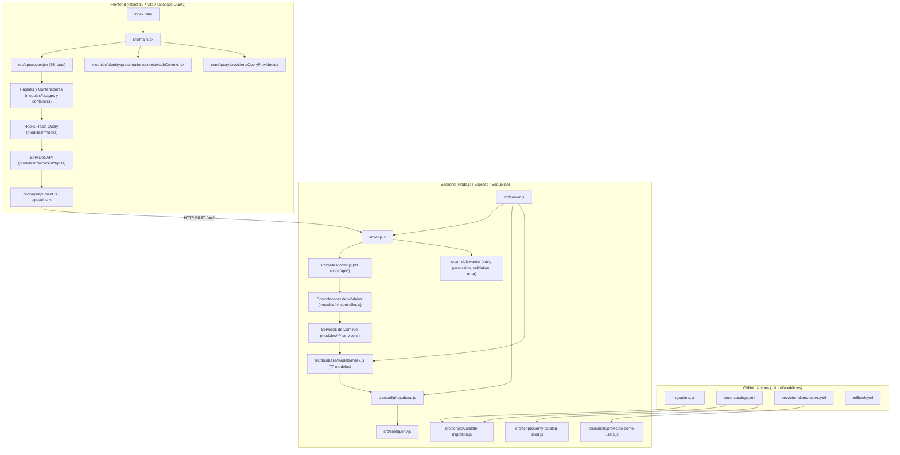

# 03 — Mapa de Dependencias y Análisis de Referencias (Fase 2)

## 1. Metodología del Análisis de Dependencias

Se construyó un analizador estático y semántico sobre los **1,431 archivos** del repositorio para trazar todas las relaciones directas e indirectas antes de autorizar cualquier eliminación:
1. **Resolución de módulos CommonJS y ES Modules**:
   - `require('...')`, `import ... from '...'`, `export ... from '...'` e importaciones dinámicas `import('...')`.
   - Resolución de alias de Vite/TypeScript (`frontend/vite.config.js` y `frontend/tsconfig.json`):
     - `@/*` $\rightarrow$ `frontend/src/*`
     - `@app/*` $\rightarrow$ `frontend/src/app/*`
     - `@core/*` $\rightarrow$ `frontend/src/core/*`
     - `@shared/*` $\rightarrow$ `frontend/src/shared/*`
     - `@modules/*` $\rightarrow$ `frontend/src/modules/*`
2. **Registro de Rutas Express (`backend/src/routes/index.js`)**: Mapeo de los **31 prefijos de endpoints** montados bajo `/api`.
3. **Registro Central de Modelos Sequelize (`backend/src/database/models/index.js`)**: Mapeo de los **77 modelos** registrados en el objeto `db`.
4. **Automatizaciones CI/CD y Scripts**:
   - `.github/workflows/migrations.yml` $\rightarrow$ consume `backend/src/scripts/validate-migration.js` y `npm run db:migrate`.
   - `.github/workflows/provision-demo-users.yml` $\rightarrow$ consume `backend/src/scripts/provision-demo-users.js`.
   - `.github/workflows/rollback.yml` $\rightarrow$ consume `npm run db:migrate:undo`.
   - `.github/workflows/seed-catalogs.yml` $\rightarrow$ consume `backend/src/scripts/validate-migration.js`, `npm run db:migrate`, `npm run db:seed:catalog` (`20260826120000-production-catalog-data.js`) y `backend/src/scripts/verify-catalog-seed.js`.
5. **Detección de Ciclos**: El recorrido DFS sobre el grafo completo de módulos resueltos arrojó **`0` ciclos de dependencia circular** (`cyclesCount: 0`).

---

## 2. Diagrama del Grafo Arquitectónico de Dependencias

---

## 3. Nodos Críticos con Mayor Acoplamiento Entrante (Top 30 Módulos Más Consumidos)

| # | Archivo Consumido | Dependencias Entrantes Directas | Rol en el Sistema |
|---:|---|---:|---|
| 1 | `frontend/src/design-system/components/Icon/googleIconCompat.tsx` | **165** | Núcleo / UI / Cliente API Frontend |
| 2 | `backend/src/database/models/index.js` | **134** | Núcleo / Modelo / Utilidad Backend |
| 3 | `frontend/src/design-system/index.ts` | **73** | Núcleo / UI / Cliente API Frontend |
| 4 | `frontend/src/store/authStore.js` | **65** | Núcleo / UI / Cliente API Frontend |
| 5 | `frontend/src/api/axiosClient.js` | **51** | Núcleo / UI / Cliente API Frontend |
| 6 | `frontend/src/components/ui/button.tsx` | **40** | Núcleo / UI / Cliente API Frontend |
| 7 | `backend/src/middlewares/auth.middleware.js` | **37** | Núcleo / Modelo / Utilidad Backend |
| 8 | `frontend/src/lib/utils.js` | **37** | Núcleo / UI / Cliente API Frontend |
| 9 | `frontend/src/utils/authHelpers.ts` | **36** | Núcleo / UI / Cliente API Frontend |
| 10 | `backend/src/middlewares/permission.middleware.js` | **34** | Núcleo / Modelo / Utilidad Backend |
| 11 | `frontend/src/components/tf-ui/index.js` | **33** | Núcleo / UI / Cliente API Frontend |
| 12 | `frontend/src/components/ui/input.tsx` | **25** | Núcleo / UI / Cliente API Frontend |
| 13 | `frontend/src/shared/domain/ports/DomainPorts.ts` | **25** | Núcleo / UI / Cliente API Frontend |
| 14 | `frontend/src/shared/ids/brandTypes.ts` | **25** | Núcleo / UI / Cliente API Frontend |
| 15 | `backend/src/shared/responses/apiResponse.js` | **24** | Núcleo / Modelo / Utilidad Backend |
| 16 | `frontend/src/components/shared/CollapsibleFilterPanel.tsx` | **24** | Núcleo / UI / Cliente API Frontend |
| 17 | `frontend/src/core/api/apiClient.ts` | **22** | Núcleo / UI / Cliente API Frontend |
| 18 | `backend/src/config/database.js` | **21** | Núcleo / Modelo / Utilidad Backend |
| 19 | `backend/src/shared/security/accessRules.js` | **20** | Núcleo / Modelo / Utilidad Backend |
| 20 | `frontend/src/core/platform/EventBus/EventBus.js` | **17** | Núcleo / UI / Cliente API Frontend |
| 21 | `frontend/src/modules/materials/hooks/useMaterialsQueries.js` | **17** | Núcleo / UI / Cliente API Frontend |
| 22 | `backend/src/services/BaseCatalogService.js` | **15** | Núcleo / Modelo / Utilidad Backend |
| 23 | `frontend/src/core/platform/EventBus/DomainEvents.js` | **15** | Núcleo / UI / Cliente API Frontend |
| 24 | `frontend/src/modules/extrusion/hooks/useExtrusionFloorQueries.ts` | **15** | Núcleo / UI / Cliente API Frontend |
| 25 | `frontend/src/modules/extrusion/types/extrusion.types.ts` | **15** | Núcleo / UI / Cliente API Frontend |
| 26 | `frontend/src/core/authorization/PermissionSet.ts` | **14** | Núcleo / UI / Cliente API Frontend |
| 27 | `frontend/src/shared/domain/AggregateRoot.ts` | **14** | Núcleo / UI / Cliente API Frontend |
| 28 | `backend/src/middlewares/validateRequest.js` | **13** | Núcleo / Modelo / Utilidad Backend |
| 29 | `frontend/src/design-system/utils.ts` | **12** | Núcleo / UI / Cliente API Frontend |
| 30 | `frontend/src/hooks/useBottomSheetAnimation.ts` | **12** | Núcleo / UI / Cliente API Frontend |

---

## 4. Mapa de Rutas Express Activas (`backend/src/routes/index.js`)

| # | Prefijo HTTP (`/api/*`) | Archivo de Rutas | Módulo Backend |
|---:|---|---|---|
| 1 | `/api/health` | `backend/src/modules/health/health.routes.js` | Health Check |
| 2 | `/api/auth` | `backend/src/modules/auth/auth.routes.js` | Autenticación JWT y sesiones |
| 3 | `/api/users` | `backend/src/modules/users/users.routes.js` | Gestión de usuarios |
| 4 | `/api/roles` | `backend/src/modules/roles/roles.routes.js` | Roles y RBAC |
| 5 | `/api/permissions` | `backend/src/modules/permissions/permissions.routes.js` | Catálogo de permisos |
| 6 | `/api/areas` | `backend/src/modules/areas/areas.routes.js` | Áreas y subáreas operativas |
| 7 | `/api/qr` | `backend/src/modules/qrcodes/qrcodes.routes.js` | Lotes QR, etiquetas PDF y árbol genealógico |
| 8 | `/api/materials` | `backend/src/modules/materials/material/material.routes.js` | Catálogo maestro de materiales |
| 9 | `/api/warehouse` | `backend/src/modules/warehouse/warehouse.routes.js` | Inventario, lotes, ODC, silos, bajas y reportes |
| 10 | `/api/material-families` | `backend/src/modules/materials/materialFamily/materialFamily.routes.js` | Subcatálogo Familias |
| 11 | `/api/material-codes` | `backend/src/modules/materials/materialCode/materialCode.routes.js` | Subcatálogo Códigos |
| 12 | `/api/material-brands` | `backend/src/modules/materials/materialBrand/materialBrand.routes.js` | Subcatálogo Marcas |
| 13 | `/api/material-types` | `backend/src/modules/materials/materialType/materialType.routes.js` | Subcatálogo Tipos |
| 14 | `/api/material-units` | `backend/src/modules/materials/materialUnit/materialUnit.routes.js` | Subcatálogo Unidades |
| 15 | `/api/operational-areas` | `backend/src/modules/materials/operationalArea/operationalArea.routes.js` | Subcatálogo Áreas Operacionales |
| 16 | `/api/locations` | `backend/src/modules/materials/location/location.routes.js` | Subcatálogo Localidades de Almacén |
| 17 | `/api/traceability` | `backend/src/modules/traceability/traceability.routes.js` | Eventos y movimientos de trazabilidad |
| 18 | `/api/suppliers` | `backend/src/modules/catalogs/supplier/supplier.routes.js` | Catálogo de Proveedores |
| 19 | `/api/tags` | `backend/src/modules/materials/tag/tag.routes.js` | Etiquetas y equivalencias de materiales |
| 20 | `/api/reports` | `backend/src/modules/reports/reports.routes.js` | Reportes generales |
| 21 | `/api/dashboard` | `backend/src/modules/dashboard/dashboard.routes.js` | Indicadores operativos y financieros |
| 22 | `/api/reception` | `backend/src/modules/reception/reception.routes.js` | Recepción de materia prima |
| 23 | `/api/notifications` | `backend/src/modules/notifications/notification.routes.js` | Centro de notificaciones |
| 24 | `/api/extrusion` | `backend/src/modules/extrusion/extrusion.routes.js` | Piso de Extrusión, mezclas, colas, racks PTI, turnos y merma |
| 25 | `/api/formulas` | `backend/src/modules/formulas/formulas.routes.js` | Fórmulas de proceso |
| 26 | `/api/telares` | `backend/src/modules/telares/telares.routes.js` | Telares, BOMs, fileta, corridas y rollo viajero |
| 27 | `/api/globo` | `backend/src/modules/globo/globo.routes.js` | Proceso WIP Globo |
| 28 | `/api/laminado` | `backend/src/modules/laminado/laminado.routes.js` | Proceso WIP Laminado |
| 29 | `/api/corte` | `backend/src/modules/corte/corte.routes.js` | Órdenes y proceso WIP Corte |

> [!WARNING]
> **Rutas existentes en `backend/src/modules/` que NO están montadas en `backend/src/routes/index.js`**:
> - `backend/src/modules/catalogs/storageLocation/storageLocation.routes.js`
> - `backend/src/modules/catalogs/storageLocationStatus/storageLocationStatus.routes.js`
> - `backend/src/modules/catalogs/storageLocationType/storageLocationType.routes.js`
> - `backend/src/modules/catalogs/warehouse/warehouse.routes.js`
> - `backend/src/modules/intermediate/intermediate.routes.js`
> - `backend/src/modules/materials/materialCategory/materialCategory.routes.js`
> - `backend/src/modules/materials/materials.routes.js` (reemplazado por `materials/material/material.routes.js`)
> - `backend/src/modules/processes/processRun.routes.js`
> - `backend/src/modules/processes/processRunTelares.routes.js`
> - `backend/src/modules/scrap/scrap.routes.js`, `scrap.dashboard.routes.js`, `scrap.report.routes.js`

---

## 5. Registro Completo de Imports No Resueltos (`59` Referencias Rotas Detectadas)

Ninguno de estos 59 imports rompe el arranque actual de `server.js` ni `vite build` porque se encuentran en scripts auxiliares (`.codex-*`, `generate_*`, `update-models.js`) o en módulos huérfanos no alcanzables desde el punto de entrada. Sin embargo, representan deuda técnica que debe limpiarse antes de la reestructuración MVC:

| # | Archivo Origen (`from`) | Import / Require No Resuelto (`target`) | Causa Técnica |
|---:|---|---|---|
| 1 | `.codex-create-e2e-db.cjs` | `backend/node_modules/dotenv (UNRESOLVED)` | Ruta relativa a `./backend/node_modules/...` usada por script temporal en raíz |
| 2 | `.codex-create-e2e-db.cjs` | `backend/node_modules/pg (UNRESOLVED)` | Ruta relativa a `./backend/node_modules/...` usada por script temporal en raíz |
| 3 | `.codex-e2e-aftermix.cjs` | `backend/node_modules/dotenv (UNRESOLVED)` | Ruta relativa a `./backend/node_modules/...` usada por script temporal en raíz |
| 4 | `.codex-e2e-aftermix.cjs` | `backend/node_modules/pg (UNRESOLVED)` | Ruta relativa a `./backend/node_modules/...` usada por script temporal en raíz |
| 5 | `.codex-e2e-check.cjs` | `backend/node_modules/dotenv (UNRESOLVED)` | Ruta relativa a `./backend/node_modules/...` usada por script temporal en raíz |
| 6 | `.codex-e2e-check.cjs` | `backend/node_modules/pg (UNRESOLVED)` | Ruta relativa a `./backend/node_modules/...` usada por script temporal en raíz |
| 7 | `.codex-e2e-create-supervisor2.cjs` | `backend/node_modules/dotenv (UNRESOLVED)` | Ruta relativa a `./backend/node_modules/...` usada por script temporal en raíz |
| 8 | `.codex-e2e-create-supervisor2.cjs` | `backend/node_modules/pg (UNRESOLVED)` | Ruta relativa a `./backend/node_modules/...` usada por script temporal en raíz |
| 9 | `.codex-e2e-formula.cjs` | `backend/node_modules/dotenv (UNRESOLVED)` | Ruta relativa a `./backend/node_modules/...` usada por script temporal en raíz |
| 10 | `.codex-e2e-formula.cjs` | `backend/node_modules/pg (UNRESOLVED)` | Ruta relativa a `./backend/node_modules/...` usada por script temporal en raíz |
| 11 | `.codex-e2e-inspect.cjs` | `backend/node_modules/dotenv (UNRESOLVED)` | Ruta relativa a `./backend/node_modules/...` usada por script temporal en raíz |
| 12 | `.codex-e2e-inspect.cjs` | `backend/node_modules/pg (UNRESOLVED)` | Ruta relativa a `./backend/node_modules/...` usada por script temporal en raíz |
| 13 | `.codex-e2e-odc-info.cjs` | `backend/node_modules/dotenv (UNRESOLVED)` | Ruta relativa a `./backend/node_modules/...` usada por script temporal en raíz |
| 14 | `.codex-e2e-odc-info.cjs` | `backend/node_modules/pg (UNRESOLVED)` | Ruta relativa a `./backend/node_modules/...` usada por script temporal en raíz |
| 15 | `.codex-e2e-schema.cjs` | `backend/node_modules/dotenv (UNRESOLVED)` | Ruta relativa a `./backend/node_modules/...` usada por script temporal en raíz |
| 16 | `.codex-e2e-schema.cjs` | `backend/node_modules/pg (UNRESOLVED)` | Ruta relativa a `./backend/node_modules/...` usada por script temporal en raíz |
| 17 | `.codex-e2e-shift-setup.cjs` | `backend/node_modules/dotenv (UNRESOLVED)` | Ruta relativa a `./backend/node_modules/...` usada por script temporal en raíz |
| 18 | `.codex-e2e-shift-setup.cjs` | `backend/node_modules/pg (UNRESOLVED)` | Ruta relativa a `./backend/node_modules/...` usada por script temporal en raíz |
| 19 | `.codex-e2e-supervisors.cjs` | `backend/node_modules/dotenv (UNRESOLVED)` | Ruta relativa a `./backend/node_modules/...` usada por script temporal en raíz |
| 20 | `.codex-e2e-supervisors.cjs` | `backend/node_modules/pg (UNRESOLVED)` | Ruta relativa a `./backend/node_modules/...` usada por script temporal en raíz |
| 21 | `.codex-e2e-wipqr.cjs` | `backend/node_modules/dotenv (UNRESOLVED)` | Ruta relativa a `./backend/node_modules/...` usada por script temporal en raíz |
| 22 | `.codex-e2e-wipqr.cjs` | `backend/node_modules/pg (UNRESOLVED)` | Ruta relativa a `./backend/node_modules/...` usada por script temporal en raíz |
| 23 | `backend/generate_catalogs.js` | `../../services/BaseCatalogService (UNRESOLVED)` | Plantilla string literal o archivo TSV histórico no existente |
| 24 | `backend/generate_catalogs.js` | `../../database/models (UNRESOLVED)` | Plantilla string literal o archivo TSV histórico no existente |
| 25 | `backend/generate_catalogs.js` | `backend/${camelName}.service (UNRESOLVED)` | Plantilla string literal o archivo TSV histórico no existente |
| 26 | `backend/generate_catalogs.js` | `../../utils/apiResponse (UNRESOLVED)` | Plantilla string literal o archivo TSV histórico no existente |
| 27 | `backend/generate_catalogs.js` | `backend/${camelName}.controller (UNRESOLVED)` | Plantilla string literal o archivo TSV histórico no existente |
| 28 | `backend/generate_catalogs.js` | `../../middlewares/validateRequest (UNRESOLVED)` | Plantilla string literal o archivo TSV histórico no existente |
| 29 | `backend/generate_catalogs.js` | `backend/${camelName}.schema (UNRESOLVED)` | Plantilla string literal o archivo TSV histórico no existente |
| 30 | `backend/generate_catalogs.js` | `../../utils/asyncHandler (UNRESOLVED)` | Plantilla string literal o archivo TSV histórico no existente |
| 31 | `backend/generate_seeders_from_text.js` | `models (UNRESOLVED)` | Plantilla string literal o archivo TSV histórico no existente |
| 32 | `backend/src/modules/catalogs/storageLocation/storageLocation.routes.js` | `backend/src/middlewares/auth (UNRESOLVED)` | El middleware real se llama `auth.middleware.js`, no `auth.js` |
| 33 | `backend/src/modules/catalogs/storageLocationStatus/storageLocationStatus.routes.js` | `backend/src/middlewares/auth (UNRESOLVED)` | El middleware real se llama `auth.middleware.js`, no `auth.js` |
| 34 | `backend/src/modules/catalogs/storageLocationType/storageLocationType.routes.js` | `backend/src/middlewares/auth (UNRESOLVED)` | El middleware real se llama `auth.middleware.js`, no `auth.js` |
| 35 | `backend/src/modules/catalogs/supplier/supplier.routes.js` | `backend/src/middleware/validateRequest (UNRESOLVED)` | Directorio mal escrito (`middleware` singular en vez de `middlewares`) |
| 36 | `backend/src/modules/catalogs/warehouse/warehouse.routes.js` | `backend/src/middlewares/auth (UNRESOLVED)` | El middleware real se llama `auth.middleware.js`, no `auth.js` |
| 37 | `backend/src/scripts/update-models.js` | `backend/modules/globo/models/globoSpecification.model (UNRESOLVED)` | String inyectado destinado a `database/models/index.js` |
| 38 | `backend/src/scripts/update-models.js` | `backend/modules/globo/models/globoSpecificationMaterial.model (UNRESOLVED)` | String inyectado destinado a `database/models/index.js` |
| 39 | `backend/src/scripts/update-models.js` | `backend/modules/laminado/models/laminadoSpecification.model (UNRESOLVED)` | String inyectado destinado a `database/models/index.js` |
| 40 | `backend/src/scripts/update-models.js` | `backend/modules/laminado/models/laminadoSpecificationMaterial.model (UNRESOLVED)` | String inyectado destinado a `database/models/index.js` |
| 41 | `frontend/src/core/api/apiClient.ts` | `frontend/src/core/api/interceptors/idempotency.interceptor (UNRESOLVED)` | Imports comentados hacia interceptores no implementados |
| 42 | `frontend/src/core/api/apiClient.ts` | `frontend/src/core/api/interceptors/retry.interceptor (UNRESOLVED)` | Imports comentados hacia interceptores no implementados |
| 43 | `frontend/src/core/api/apiClient.ts` | `frontend/src/core/api/interceptors/error.interceptor (UNRESOLVED)` | Imports comentados hacia interceptores no implementados |
| 44 | `frontend/src/design-system/components/scanner-overlay/ScannerOverlay.jsx` | `frontend/src/design-system/components/button/PrimitiveButton (UNRESOLVED)` | Archivo DDD/UI huérfano que apunta a ValueObject, Port o componente no creado |
| 45 | `frontend/src/modules/catalogs/services/catalogsApi.js` | `frontend/src/lib/api (UNRESOLVED)` | Archivo DDD/UI huérfano que apunta a ValueObject, Port o componente no creado |
| 46 | `frontend/src/modules/identity/application/commands/TransferCustodyCommands.ts` | `frontend/src/modules/identity/application/valueObjects/CustodyValueObjects (UNRESOLVED)` | Archivo DDD/UI huérfano que apunta a ValueObject, Port o componente no creado |
| 47 | `frontend/src/modules/identity/domain/policies/authorization/IdentityAuthorizationPolicies.ts` | `frontend/src/modules/identity/domain/policies/authorization/IdentityToken (UNRESOLVED)` | Archivo DDD/UI huérfano que apunta a ValueObject, Port o componente no creado |
| 48 | `frontend/src/modules/identity/domain/ports/IndustrialCodeGeneratorPort.ts` | `frontend/src/modules/identity/valueObjects/IdentityValueObjects (UNRESOLVED)` | Archivo DDD/UI huérfano que apunta a ValueObject, Port o componente no creado |
| 49 | `frontend/src/modules/identity/infrastructure/events/handlers/AuditIdentityGenerationHandler.ts` | `frontend/src/modules/identity/infrastructure/events/events/IdentityDomainEvents (UNRESOLVED)` | Archivo DDD/UI huérfano que apunta a ValueObject, Port o componente no creado |
| 50 | `frontend/src/modules/production/application/handlers/ExecuteMixingHandler.ts` | `frontend/src/shared/domain/events/DomainEventBusPort (UNRESOLVED)` | Archivo DDD/UI huérfano que apunta a ValueObject, Port o componente no creado |
| 51 | `frontend/src/modules/production/application/handlers/StartProductionRunHandler.ts` | `frontend/src/shared/domain/events/DomainEventBusPort (UNRESOLVED)` | Archivo DDD/UI huérfano que apunta a ValueObject, Port o componente no creado |
| 52 | `frontend/src/modules/production/application/ports/WeightScalePort.ts` | `frontend/src/modules/production/application/domain/valueObjects/TransformationValueObjects (UNRESOLVED)` | Archivo DDD/UI huérfano que apunta a ValueObject, Port o componente no creado |
| 53 | `frontend/src/modules/production/domain/entities/Rack.ts` | `frontend/src/modules/catalog/domain/valueObjects/UnitOfMeasure (UNRESOLVED)` | Archivo DDD/UI huérfano que apunta a ValueObject, Port o componente no creado |
| 54 | `frontend/src/modules/production/domain/valueObjects/TransformationValueObjects.ts` | `frontend/src/modules/catalog/domain/valueObjects/UnitOfMeasure (UNRESOLVED)` | Archivo DDD/UI huérfano que apunta a ValueObject, Port o componente no creado |
| 55 | `frontend/src/modules/production/engine/ProcessIO.ts` | `frontend/src/catalog/domain/valueObjects/UnitOfMeasure (UNRESOLVED)` | Archivo DDD/UI huérfano que apunta a ValueObject, Port o componente no creado |
| 56 | `frontend/src/modules/warehouse/application/dto/WarehouseDTOs.ts` | `frontend/src/modules/warehouse/catalog/domain/valueObjects/UnitOfMeasure (UNRESOLVED)` | Archivo DDD/UI huérfano que apunta a ValueObject, Port o componente no creado |
| 57 | `frontend/src/modules/warehouse/application/handlers/RegisterMaterialEntryHandler.ts` | `frontend/src/shared/domain/events/DomainEventBusPort (UNRESOLVED)` | Archivo DDD/UI huérfano que apunta a ValueObject, Port o componente no creado |
| 58 | `frontend/src/modules/warehouse/domain/events/WarehouseEvents.ts` | `frontend/src/modules/warehouse/catalog/domain/valueObjects/UnitOfMeasure (UNRESOLVED)` | Archivo DDD/UI huérfano que apunta a ValueObject, Port o componente no creado |
| 59 | `frontend/src/modules/warehouse/domain/valueObjects/WarehouseValueObjects.ts` | `frontend/src/modules/warehouse/catalog/domain/valueObjects/UnitOfMeasure (UNRESOLVED)` | Archivo DDD/UI huérfano que apunta a ValueObject, Port o componente no creado |

---

## 6. Inventario Completo de Archivos Huérfanos en Código Fuente (`0` Referencias Entrantes)

### 6.1 Archivos Huérfanos en `backend/src/` (`46` archivos)
*(Excluyendo puntos de entrada, migraciones, seeders, scripts CLI y archivos `.test.js`)*

| # | Archivo en `backend/src/` | Líneas | Estado Git | Diagnóstico de Dependencias |
|---:|---|---:|---|---|
| 1 | `backend/src/config/jwt.js` | 1 | `TRACKED_CLEAN` | Sin `require()` entrante desde `server.js`, `routes/index.js` ni `database/models/index.js`. |
| 2 | `backend/src/middlewares/errorHandler.js` | 62 | `TRACKED_CLEAN` | Sin `require()` entrante desde `server.js`, `routes/index.js` ni `database/models/index.js`. |
| 3 | `backend/src/modules/catalogs/storageLocation/storageLocation.model.js` | 60 | `TRACKED_CLEAN` | Sin `require()` entrante desde `server.js`, `routes/index.js` ni `database/models/index.js`. |
| 4 | `backend/src/modules/catalogs/storageLocation/storageLocation.routes.js` | 19 | `TRACKED_CLEAN` | Sin `require()` entrante desde `server.js`, `routes/index.js` ni `database/models/index.js`. |
| 5 | `backend/src/modules/catalogs/storageLocationStatus/storageLocationStatus.model.js` | 32 | `TRACKED_CLEAN` | Sin `require()` entrante desde `server.js`, `routes/index.js` ni `database/models/index.js`. |
| 6 | `backend/src/modules/catalogs/storageLocationStatus/storageLocationStatus.routes.js` | 19 | `TRACKED_CLEAN` | Sin `require()` entrante desde `server.js`, `routes/index.js` ni `database/models/index.js`. |
| 7 | `backend/src/modules/catalogs/storageLocationType/storageLocationType.model.js` | 32 | `TRACKED_CLEAN` | Sin `require()` entrante desde `server.js`, `routes/index.js` ni `database/models/index.js`. |
| 8 | `backend/src/modules/catalogs/storageLocationType/storageLocationType.routes.js` | 19 | `TRACKED_CLEAN` | Sin `require()` entrante desde `server.js`, `routes/index.js` ni `database/models/index.js`. |
| 9 | `backend/src/modules/catalogs/warehouse/warehouse.model.js` | 33 | `TRACKED_CLEAN` | Sin `require()` entrante desde `server.js`, `routes/index.js` ni `database/models/index.js`. |
| 10 | `backend/src/modules/catalogs/warehouse/warehouse.routes.js` | 20 | `TRACKED_CLEAN` | Sin `require()` entrante desde `server.js`, `routes/index.js` ni `database/models/index.js`. |
| 11 | `backend/src/modules/extrusion/models/extrusionPtiSaleExit.model.js` | 16 | `TRACKED_CLEAN` | Sin `require()` entrante desde `server.js`, `routes/index.js` ni `database/models/index.js`. |
| 12 | `backend/src/modules/extrusion/models/extrusionPtiWarehouseTransfer.model.js` | 26 | `TRACKED_CLEAN` | Sin `require()` entrante desde `server.js`, `routes/index.js` ni `database/models/index.js`. |
| 13 | `backend/src/modules/formulas/formulas.constants.js` | 25 | `TRACKED_CLEAN` | Sin `require()` entrante desde `server.js`, `routes/index.js` ni `database/models/index.js`. |
| 14 | `backend/src/modules/intermediate/intermediate.routes.js` | 75 | `TRACKED_CLEAN` | Sin `require()` entrante desde `server.js`, `routes/index.js` ni `database/models/index.js`. |
| 15 | `backend/src/modules/intermediate/intermediateMaterial.model.js` | 136 | `TRACKED_CLEAN` | Sin `require()` entrante desde `server.js`, `routes/index.js` ni `database/models/index.js`. |
| 16 | `backend/src/modules/intermediate/intermediateStock.model.js` | 85 | `TRACKED_CLEAN` | Sin `require()` entrante desde `server.js`, `routes/index.js` ni `database/models/index.js`. |
| 17 | `backend/src/modules/intermediate/intermediateStockMovement.model.js` | 114 | `TRACKED_CLEAN` | Sin `require()` entrante desde `server.js`, `routes/index.js` ni `database/models/index.js`. |
| 18 | `backend/src/modules/intermediate/storageRack.model.js` | 83 | `TRACKED_CLEAN` | Sin `require()` entrante desde `server.js`, `routes/index.js` ni `database/models/index.js`. |
| 19 | `backend/src/modules/materials/materialCategory/materialCategory.routes.js` | 22 | `TRACKED_CLEAN` | Sin `require()` entrante desde `server.js`, `routes/index.js` ni `database/models/index.js`. |
| 20 | `backend/src/modules/materials/materialCategory.model.js` | 35 | `TRACKED_CLEAN` | Sin `require()` entrante desde `server.js`, `routes/index.js` ni `database/models/index.js`. |
| 21 | `backend/src/modules/materials/materials.constants.js` | 20 | `TRACKED_CLEAN` | Sin `require()` entrante desde `server.js`, `routes/index.js` ni `database/models/index.js`. |
| 22 | `backend/src/modules/materials/materials.routes.js` | 140 | `TRACKED_CLEAN` | Sin `require()` entrante desde `server.js`, `routes/index.js` ni `database/models/index.js`. |
| 23 | `backend/src/modules/materials/materialSubcategory.model.js` | 46 | `TRACKED_CLEAN` | Sin `require()` entrante desde `server.js`, `routes/index.js` ni `database/models/index.js`. |
| 24 | `backend/src/modules/materials/operationalArea.model.js` | 35 | `TRACKED_CLEAN` | Sin `require()` entrante desde `server.js`, `routes/index.js` ni `database/models/index.js`. |
| 25 | `backend/src/modules/processes/processOutputItem.model.js` | 45 | `TRACKED_CLEAN` | Sin `require()` entrante desde `server.js`, `routes/index.js` ni `database/models/index.js`. |
| 26 | `backend/src/modules/processes/processRun.model.js` | 81 | `TRACKED_CLEAN` | Sin `require()` entrante desde `server.js`, `routes/index.js` ni `database/models/index.js`. |
| 27 | `backend/src/modules/processes/processRun.routes.js` | 45 | `TRACKED_CLEAN` | Sin `require()` entrante desde `server.js`, `routes/index.js` ni `database/models/index.js`. |
| 28 | `backend/src/modules/processes/processRunInput.model.js` | 75 | `TRACKED_CLEAN` | Sin `require()` entrante desde `server.js`, `routes/index.js` ni `database/models/index.js`. |
| 29 | `backend/src/modules/processes/processRunOutput.model.js` | 109 | `TRACKED_CLEAN` | Sin `require()` entrante desde `server.js`, `routes/index.js` ni `database/models/index.js`. |
| 30 | `backend/src/modules/processes/processRunTelares.routes.js` | 52 | `TRACKED_CLEAN` | Sin `require()` entrante desde `server.js`, `routes/index.js` ni `database/models/index.js`. |
| 31 | `backend/src/modules/qrcodes/qrEvent.model.js` | 55 | `TRACKED_CLEAN` | Sin `require()` entrante desde `server.js`, `routes/index.js` ni `database/models/index.js`. |
| 32 | `backend/src/modules/scrap/scrap.dashboard.routes.js` | 50 | `TRACKED_CLEAN` | Sin `require()` entrante desde `server.js`, `routes/index.js` ni `database/models/index.js`. |
| 33 | `backend/src/modules/scrap/scrap.report.routes.js` | 15 | `TRACKED_CLEAN` | Sin `require()` entrante desde `server.js`, `routes/index.js` ni `database/models/index.js`. |
| 34 | `backend/src/modules/scrap/scrap.routes.js` | 68 | `TRACKED_CLEAN` | Sin `require()` entrante desde `server.js`, `routes/index.js` ni `database/models/index.js`. |
| 35 | `backend/src/modules/scrap/scrap.service.js` | 339 | `TRACKED_CLEAN` | Sin `require()` entrante desde `server.js`, `routes/index.js` ni `database/models/index.js`. |
| 36 | `backend/src/modules/scrap/scrapCatalog.model.js` | 56 | `TRACKED_CLEAN` | Sin `require()` entrante desde `server.js`, `routes/index.js` ni `database/models/index.js`. |
| 37 | `backend/src/modules/scrap/scrapContainer.model.js` | 102 | `TRACKED_CLEAN` | Sin `require()` entrante desde `server.js`, `routes/index.js` ni `database/models/index.js`. |
| 38 | `backend/src/modules/scrap/scrapContainerStock.model.js` | 44 | `TRACKED_CLEAN` | Sin `require()` entrante desde `server.js`, `routes/index.js` ni `database/models/index.js`. |
| 39 | `backend/src/modules/scrap/scrapMovement.model.js` | 61 | `TRACKED_CLEAN` | Sin `require()` entrante desde `server.js`, `routes/index.js` ni `database/models/index.js`. |
| 40 | `backend/src/modules/scrap/scrapStockMovement.model.js` | 78 | `TRACKED_CLEAN` | Sin `require()` entrante desde `server.js`, `routes/index.js` ni `database/models/index.js`. |
| 41 | `backend/src/modules/scrap/scrapType.model.js` | 60 | `TRACKED_CLEAN` | Sin `require()` entrante desde `server.js`, `routes/index.js` ni `database/models/index.js`. |
| 42 | `backend/src/modules/warehouse/stockUnit.model.js` | 68 | `TRACKED_CLEAN` | Sin `require()` entrante desde `server.js`, `routes/index.js` ni `database/models/index.js`. |
| 43 | `backend/src/modules/waste/wasteReason.model.js` | 1 | `TRACKED_CLEAN` | Sin `require()` entrante desde `server.js`, `routes/index.js` ni `database/models/index.js`. |
| 44 | `backend/src/shared/helpers/buildScrapMovement.helper.js` | 37 | `TRACKED_CLEAN` | Sin `require()` entrante desde `server.js`, `routes/index.js` ni `database/models/index.js`. |
| 45 | `backend/src/shared/helpers/inventoryStatus.helper.js` | 25 | `TRACKED_CLEAN` | Sin `require()` entrante desde `server.js`, `routes/index.js` ni `database/models/index.js`. |
| 46 | `backend/src/shared/utils/transactionRetry.js` | 42 | `TRACKED_CLEAN` | Sin `require()` entrante desde `server.js`, `routes/index.js` ni `database/models/index.js`. |

### 6.2 Archivos Huérfanos en `frontend/src/` (`82` archivos)
*(Excluyendo `main.jsx`, `testing/setup.js` y archivos `.test.*`, no alcanzables desde `app/router.jsx`)*

| # | Archivo en `frontend/src/` | Líneas | Estado Git | Diagnóstico de Dependencias |
|---:|---|---:|---|---|
| 1 | `frontend/src/app/AdminDashboard.tsx` | 108 | `TRACKED_CLEAN` | Sin `import` entrante desde el árbol de componentes montado por `main.jsx` / `router.jsx`. |
| 2 | `frontend/src/app/App.jsx` | 8 | `TRACKED_CLEAN` | Sin `import` entrante desde el árbol de componentes montado por `main.jsx` / `router.jsx`. |
| 3 | `frontend/src/components/layout/Header.jsx` | 58 | `TRACKED_CLEAN` | Sin `import` entrante desde el árbol de componentes montado por `main.jsx` / `router.jsx`. |
| 4 | `frontend/src/components/layout/MainContent.jsx` | 16 | `TRACKED_CLEAN` | Sin `import` entrante desde el árbol de componentes montado por `main.jsx` / `router.jsx`. |
| 5 | `frontend/src/components/layout/MobileBottomNav.jsx` | 91 | `TRACKED_CLEAN` | Sin `import` entrante desde el árbol de componentes montado por `main.jsx` / `router.jsx`. |
| 6 | `frontend/src/components/layout/UserSessionBox.jsx` | 33 | `TRACKED_CLEAN` | Sin `import` entrante desde el árbol de componentes montado por `main.jsx` / `router.jsx`. |
| 7 | `frontend/src/components/ui/alert-dialog.tsx` | 144 | `TRACKED_CLEAN` | Sin `import` entrante desde el árbol de componentes montado por `main.jsx` / `router.jsx`. |
| 8 | `frontend/src/components/ui/sheet.tsx` | 141 | `TRACKED_CLEAN` | Sin `import` entrante desde el árbol de componentes montado por `main.jsx` / `router.jsx`. |
| 9 | `frontend/src/components/ui/tooltip.tsx` | 33 | `TRACKED_CLEAN` | Sin `import` entrante desde el árbol de componentes montado por `main.jsx` / `router.jsx`. |
| 10 | `frontend/src/core/authorization/rbac.ts` | 45 | `TRACKED_CLEAN` | Sin `import` entrante desde el árbol de componentes montado por `main.jsx` / `router.jsx`. |
| 11 | `frontend/src/core/events/EventBus.ts` | 46 | `TRACKED_CLEAN` | Sin `import` entrante desde el árbol de componentes montado por `main.jsx` / `router.jsx`. |
| 12 | `frontend/src/core/qr-workspace/hooks/useActionMutation.ts` | 29 | `TRACKED_CLEAN` | Sin `import` entrante desde el árbol de componentes montado por `main.jsx` / `router.jsx`. |
| 13 | `frontend/src/core/workflow/workflow.types.ts` | 11 | `TRACKED_CLEAN` | Sin `import` entrante desde el árbol de componentes montado por `main.jsx` / `router.jsx`. |
| 14 | `frontend/src/design-system/components/Input/Input.jsx` | 82 | `TRACKED_CLEAN` | Sin `import` entrante desde el árbol de componentes montado por `main.jsx` / `router.jsx`. |
| 15 | `frontend/src/design-system/playground/DesignSystemLab.jsx` | 121 | `TRACKED_CLEAN` | Sin `import` entrante desde el árbol de componentes montado por `main.jsx` / `router.jsx`. |
| 16 | `frontend/src/design-system/playground/DesignSystemPlayground.jsx` | 105 | `TRACKED_CLEAN` | Sin `import` entrante desde el árbol de componentes montado por `main.jsx` / `router.jsx`. |
| 17 | `frontend/src/design-system/tokens.js` | 62 | `TRACKED_CLEAN` | Sin `import` entrante desde el árbol de componentes montado por `main.jsx` / `router.jsx`. |
| 18 | `frontend/src/lib/utils.ts` | 7 | `TRACKED_CLEAN` | Sin `import` entrante desde el árbol de componentes montado por `main.jsx` / `router.jsx`. |
| 19 | `frontend/src/modules/areas/pages/AreasPage.jsx` | 208 | `TRACKED_CLEAN` | Sin `import` entrante desde el árbol de componentes montado por `main.jsx` / `router.jsx`. |
| 20 | `frontend/src/modules/calidad/screens/QualityStationScreen.tsx` | 99 | `TRACKED_CLEAN` | Sin `import` entrante desde el árbol de componentes montado por `main.jsx` / `router.jsx`. |
| 21 | `frontend/src/modules/catalogs/hooks/useCatalogsQueries.js` | 57 | `TRACKED_CLEAN` | Sin `import` entrante desde el árbol de componentes montado por `main.jsx` / `router.jsx`. |
| 22 | `frontend/src/modules/catalogs/layouts/CatalogsLayout.jsx` | 60 | `TRACKED_CLEAN` | Sin `import` entrante desde el árbol de componentes montado por `main.jsx` / `router.jsx`. |
| 23 | `frontend/src/modules/catalogs/pages/CatalogPages.jsx` | 68 | `TRACKED_CLEAN` | Sin `import` entrante desde el árbol de componentes montado por `main.jsx` / `router.jsx`. |
| 24 | `frontend/src/modules/dashboard/components/FinancialDashboard.jsx` | 218 | `TRACKED_CLEAN` | Sin `import` entrante desde el árbol de componentes montado por `main.jsx` / `router.jsx`. |
| 25 | `frontend/src/modules/dashboard/constants/dashboardCards.js` | 55 | `TRACKED_CLEAN` | Sin `import` entrante desde el árbol de componentes montado por `main.jsx` / `router.jsx`. |
| 26 | `frontend/src/modules/dashboard/screens/OperationsCenterScreen.tsx` | 97 | `TRACKED_CLEAN` | Sin `import` entrante desde el árbol de componentes montado por `main.jsx` / `router.jsx`. |
| 27 | `frontend/src/modules/dev/pages/UiPreviewPage.jsx` | 214 | `TRACKED_CLEAN` | Sin `import` entrante desde el árbol de componentes montado por `main.jsx` / `router.jsx`. |
| 28 | `frontend/src/modules/dev/screens/PlaygroundScreen.tsx` | 159 | `TRACKED_CLEAN` | Sin `import` entrante desde el árbol de componentes montado por `main.jsx` / `router.jsx`. |
| 29 | `frontend/src/modules/extrusion/presentation/presenters/PtiCatalogPanel.tsx` | 250 | `TRACKED_CLEAN` | Sin `import` entrante desde el árbol de componentes montado por `main.jsx` / `router.jsx`. |
| 30 | `frontend/src/modules/extrusion/screens/ExtrusionStationScreen.tsx` | 84 | `TRACKED_CLEAN` | Sin `import` entrante desde el árbol de componentes montado por `main.jsx` / `router.jsx`. |
| 31 | `frontend/src/modules/identity/application/handlers/ApproveBatchHandler.ts` | 32 | `TRACKED_CLEAN` | Sin `import` entrante desde el árbol de componentes montado por `main.jsx` / `router.jsx`. |
| 32 | `frontend/src/modules/identity/application/handlers/CancelIdentityHandler.ts` | 38 | `TRACKED_CLEAN` | Sin `import` entrante desde el árbol de componentes montado por `main.jsx` / `router.jsx`. |
| 33 | `frontend/src/modules/identity/application/handlers/RejectBatchHandler.ts` | 32 | `TRACKED_CLEAN` | Sin `import` entrante desde el árbol de componentes montado por `main.jsx` / `router.jsx`. |
| 34 | `frontend/src/modules/identity/domain/entities/LabelTemplate.ts` | 35 | `TRACKED_CLEAN` | Sin `import` entrante desde el árbol de componentes montado por `main.jsx` / `router.jsx`. |
| 35 | `frontend/src/modules/identity/index.ts` | 6 | `TRACKED_CLEAN` | Sin `import` entrante desde el árbol de componentes montado por `main.jsx` / `router.jsx`. |
| 36 | `frontend/src/modules/identity/infrastructure/printer/adapters/MockPrinterAdapter.ts` | 24 | `TRACKED_CLEAN` | Sin `import` entrante desde el árbol de componentes montado por `main.jsx` / `router.jsx`. |
| 37 | `frontend/src/modules/identity/presentation/components/IdentityDrawer.tsx` | 77 | `TRACKED_CLEAN` | Sin `import` entrante desde el árbol de componentes montado por `main.jsx` / `router.jsx`. |
| 38 | `frontend/src/modules/identity/presentation/context/RoleSwitcher.tsx` | 28 | `TRACKED_CLEAN` | Sin `import` entrante desde el árbol de componentes montado por `main.jsx` / `router.jsx`. |
| 39 | `frontend/src/modules/materials/components/CategoryDeactivateDialog.jsx` | 114 | `TRACKED_CLEAN` | Sin `import` entrante desde el árbol de componentes montado por `main.jsx` / `router.jsx`. |
| 40 | `frontend/src/modules/materials/components/MaterialDeactivateDialog.jsx` | 123 | `TRACKED_CLEAN` | Sin `import` entrante desde el árbol de componentes montado por `main.jsx` / `router.jsx`. |
| 41 | `frontend/src/modules/materials/components/SubcatalogActionButtons.jsx` | 59 | `TRACKED_CLEAN` | Sin `import` entrante desde el árbol de componentes montado por `main.jsx` / `router.jsx`. |
| 42 | `frontend/src/modules/preparacion-formulas/screens/FormulaPreparationScreen.tsx` | 103 | `TRACKED_CLEAN` | Sin `import` entrante desde el árbol de componentes montado por `main.jsx` / `router.jsx`. |
| 43 | `frontend/src/modules/production/application/commands/ChangeMachineHealthCommand.ts` | 9 | `TRACKED_CLEAN` | Sin `import` entrante desde el árbol de componentes montado por `main.jsx` / `router.jsx`. |
| 44 | `frontend/src/modules/production/application/handlers/StartProductionRunHandler.ts` | 68 | `TRACKED_CLEAN` | Sin `import` entrante desde el árbol de componentes montado por `main.jsx` / `router.jsx`. |
| 45 | `frontend/src/modules/production/index.ts` | 6 | `TRACKED_CLEAN` | Sin `import` entrante desde el árbol de componentes montado por `main.jsx` / `router.jsx`. |
| 46 | `frontend/src/modules/production/infrastructure/adapters/ManualWeightAdapter.ts` | 21 | `TRACKED_CLEAN` | Sin `import` entrante desde el árbol de componentes montado por `main.jsx` / `router.jsx`. |
| 47 | `frontend/src/modules/production/infrastructure/adapters/MockIdentityAssignmentPort.ts` | 10 | `TRACKED_CLEAN` | Sin `import` entrante desde el árbol de componentes montado por `main.jsx` / `router.jsx`. |
| 48 | `frontend/src/modules/production/infrastructure/repositories/InMemoryProductionRepository.ts` | 35 | `TRACKED_CLEAN` | Sin `import` entrante desde el árbol de componentes montado por `main.jsx` / `router.jsx`. |
| 49 | `frontend/src/modules/production/presentation/hooks/useExtrusion.ts` | 44 | `TRACKED_CLEAN` | Sin `import` entrante desde el árbol de componentes montado por `main.jsx` / `router.jsx`. |
| 50 | `frontend/src/modules/production/presentation/hooks/useMixing.ts` | 11 | `TRACKED_CLEAN` | Sin `import` entrante desde el árbol de componentes montado por `main.jsx` / `router.jsx`. |
| 51 | `frontend/src/modules/production/presentation/pages/ProductionDashboard.jsx` | 123 | `TRACKED_CLEAN` | Sin `import` entrante desde el árbol de componentes montado por `main.jsx` / `router.jsx`. |
| 52 | `frontend/src/modules/qrcodes/components/QrActionSheet.jsx` | 45 | `TRACKED_CLEAN` | Sin `import` entrante desde el árbol de componentes montado por `main.jsx` / `router.jsx`. |
| 53 | `frontend/src/modules/qrcodes/components/QrAssignForm.jsx` | 229 | `TRACKED_CLEAN` | Sin `import` entrante desde el árbol de componentes montado por `main.jsx` / `router.jsx`. |
| 54 | `frontend/src/modules/qrcodes/components/QrCancelDialog.jsx` | 156 | `TRACKED_CLEAN` | Sin `import` entrante desde el árbol de componentes montado por `main.jsx` / `router.jsx`. |
| 55 | `frontend/src/modules/qrcodes/components/QrCodesTable.jsx` | 129 | `TRACKED_CLEAN` | Sin `import` entrante desde el árbol de componentes montado por `main.jsx` / `router.jsx`. |
| 56 | `frontend/src/modules/qrcodes/components/QrEventsPanel.jsx` | 99 | `TRACKED_CLEAN` | Sin `import` entrante desde el árbol de componentes montado por `main.jsx` / `router.jsx`. |
| 57 | `frontend/src/modules/qrcodes/components/QrFiltersPanel.jsx` | 73 | `TRACKED_CLEAN` | Sin `import` entrante desde el árbol de componentes montado por `main.jsx` / `router.jsx`. |
| 58 | `frontend/src/modules/qrcodes/components/QrGenerateForm.jsx` | 128 | `TRACKED_CLEAN` | Sin `import` entrante desde el árbol de componentes montado por `main.jsx` / `router.jsx`. |
| 59 | `frontend/src/modules/qrcodes/components/QrListSection.jsx` | 111 | `TRACKED_CLEAN` | Sin `import` entrante desde el árbol de componentes montado por `main.jsx` / `router.jsx`. |
| 60 | `frontend/src/modules/qrcodes/components/QrModuleHeader.jsx` | 111 | `TRACKED_CLEAN` | Sin `import` entrante desde el árbol de componentes montado por `main.jsx` / `router.jsx`. |
| 61 | `frontend/src/modules/qrcodes/components/QrSummaryCard.jsx` | 61 | `TRACKED_CLEAN` | Sin `import` entrante desde el árbol de componentes montado por `main.jsx` / `router.jsx`. |
| 62 | `frontend/src/modules/qrcodes/components/QrValidatePanel.jsx` | 144 | `TRACKED_CLEAN` | Sin `import` entrante desde el árbol de componentes montado por `main.jsx` / `router.jsx`. |
| 63 | `frontend/src/modules/reception/ReceptionCommands.js` | 2 | `TRACKED_CLEAN` | Sin `import` entrante desde el árbol de componentes montado por `main.jsx` / `router.jsx`. |
| 64 | `frontend/src/modules/reception/ReceptionCommands.ts` | 41 | `TRACKED_CLEAN` | Sin `import` entrante desde el árbol de componentes montado por `main.jsx` / `router.jsx`. |
| 65 | `frontend/src/modules/reports/pages/ReportsPage.jsx` | 12 | `TRACKED_CLEAN` | Sin `import` entrante desde el árbol de componentes montado por `main.jsx` / `router.jsx`. |
| 66 | `frontend/src/modules/scrap/index.ts` | 6 | `TRACKED_CLEAN` | Sin `import` entrante desde el árbol de componentes montado por `main.jsx` / `router.jsx`. |
| 67 | `frontend/src/modules/scrap/screens/WasteRegistrationStationScreen.tsx` | 91 | `TRACKED_CLEAN` | Sin `import` entrante desde el árbol de componentes montado por `main.jsx` / `router.jsx`. |
| 68 | `frontend/src/modules/traceability/index.ts` | 6 | `TRACKED_CLEAN` | Sin `import` entrante desde el árbol de componentes montado por `main.jsx` / `router.jsx`. |
| 69 | `frontend/src/modules/users/services/usersApi.js` | 1 | `TRACKED_CLEAN` | Sin `import` entrante desde el árbol de componentes montado por `main.jsx` / `router.jsx`. |
| 70 | `frontend/src/modules/warehouse/index.js` | 13 | `TRACKED_CLEAN` | Sin `import` entrante desde el árbol de componentes montado por `main.jsx` / `router.jsx`. |
| 71 | `frontend/src/modules/warehouse/presentation/components/ConsumptionOrderPrintTemplate.tsx` | 145 | `TRACKED_CLEAN` | Sin `import` entrante desde el árbol de componentes montado por `main.jsx` / `router.jsx`. |
| 72 | `frontend/src/modules/warehouse/presentation/pages/WarehouseTerminalPage.tsx` | 16 | `TRACKED_CLEAN` | Sin `import` entrante desde el árbol de componentes montado por `main.jsx` / `router.jsx`. |
| 73 | `frontend/src/pages/TestTablePage.jsx` | 110 | `TRACKED_CLEAN` | Sin `import` entrante desde el árbol de componentes montado por `main.jsx` / `router.jsx`. |
| 74 | `frontend/src/providers/AppQueryProvider.jsx` | 28 | `TRACKED_CLEAN` | Sin `import` entrante desde el árbol de componentes montado por `main.jsx` / `router.jsx`. |
| 75 | `frontend/src/services/api/reports.js` | 31 | `TRACKED_CLEAN` | Sin `import` entrante desde el árbol de componentes montado por `main.jsx` / `router.jsx`. |
| 76 | `frontend/src/shared/components/domain/states/EmptyState.tsx` | 18 | `TRACKED_CLEAN` | Sin `import` entrante desde el árbol de componentes montado por `main.jsx` / `router.jsx`. |
| 77 | `frontend/src/shared/config/features.ts` | 5 | `TRACKED_CLEAN` | Sin `import` entrante desde el árbol de componentes montado por `main.jsx` / `router.jsx`. |
| 78 | `frontend/src/shared/lib/logger.ts` | 29 | `TRACKED_CLEAN` | Sin `import` entrante desde el árbol de componentes montado por `main.jsx` / `router.jsx`. |
| 79 | `frontend/src/shared/utils/groupIdenticalRecipeLines.ts` | 44 | `TRACKED_CLEAN` | Sin `import` entrante desde el árbol de componentes montado por `main.jsx` / `router.jsx`. |
| 80 | `frontend/src/shared/validation/commonSchemas.ts` | 13 | `TRACKED_CLEAN` | Sin `import` entrante desde el árbol de componentes montado por `main.jsx` / `router.jsx`. |
| 81 | `frontend/src/testing/harness/RuntimeAssertions.js` | 54 | `TRACKED_CLEAN` | Sin `import` entrante desde el árbol de componentes montado por `main.jsx` / `router.jsx`. |
| 82 | `frontend/src/testing/harness/WorkspaceHarness.jsx` | 92 | `TRACKED_CLEAN` | Sin `import` entrante desde el árbol de componentes montado por `main.jsx` / `router.jsx`. |

---

## 7. Variables de Entorno Consumidas por el Sistema (Sin Valores)

| Variable de Entorno | Consumida Por | Propósito Operativo |
|---|---|---|
| `NODE_ENV` | `backend/src/app.js`, `config/env.js`, `middlewares/error.middleware.js` | Define el modo de ejecución (`development`, `test`, `production`). |
| `PORT` | `backend/src/server.js`, `config/env.js` | Puerto TCP del servidor HTTP Express (default `4000`). |
| `TZ`, `TIMEZONE`, `TIMEZONE_STANDARD_CODE`, `UTC_OFFSET` | `backend/src/server.js`, `app.js`, `config/env.js`, `utils/timezone.js` | Zona horaria industrial forzada a `America/Mexico_City` (`CST / UTC-6`). |
| `CLIENT_URL` | `backend/src/app.js`, `config/env.js` | Lista separada por comas de orígenes permitidos en CORS. |
| `DB_HOST`, `DB_PORT`, `DB_NAME`, `DB_USER`, `DB_PASSWORD` | `backend/src/config/env.js`, `database.js`, `sequelize-cli.config.js` | Parámetros de conexión PostgreSQL para desarrollo local y pruebas. |
| `DATABASE_URL` | `backend/src/config/env.js`, `database.js`, `sequelize-cli.config.js`, `.github/workflows/*.yml` | Cadena de conexión PostgreSQL con SSL para ambientes en la nube (Neon). |
| `JWT_SECRET`, `JWT_EXPIRES_IN` | `backend/src/config/env.js`, `modules/auth/auth.service.js` | Firma y expiración de tokens de sesión JWT (`>= 32` bytes obligatorio en producción). |
| `QR_ENCRYPTION_KEY`, `QR_LEGACY_DECRYPTION_KEY` | `backend/src/shared/utils/crypto.utils.js` | Cifrado AES-256-GCM de payloads QR nuevos y descifrado compatible AES-CBC legado. |
| `DEMO_SUPERVISOR_*`, `DEMO_GLOBAL_*` | `backend/src/scripts/provision-demo-users.js`, `.github/workflows/provision-demo-users.yml` | Variables de aprovisionamiento seguro de cuentas de demostración desde GitHub Actions. |
| `RUN_EXTRUSION_LOCAL_INTEGRATION`, `RUN_CORTE_LAMINADO_LOCAL_INTEGRATION`, `RUN_TELARES_LOCAL_E2E`, `RUN_EXTRUSION_PP_PACKAGE_INTEGRATION`, `RUN_EXTRUSION_SHIFT_HANDOFF_LOCAL`, `RUN_EXTRUSION_TRANSFER_LOCAL` | `backend/test/*.local.integration.test.js` | Banderas de activación explícita (`=== '1'`) para pruebas de integración locales con rollback transaccional. |
| `VITE_API_URL`, `VITE_ENV`, `VITE_ENABLE_MOCKING` | `frontend/src/core/api/apiClient.ts`, `frontend/src/api/axios.js` | URL base del backend API consumida por el cliente HTTP de React. |
