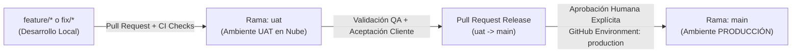

# 10 — Estrategia y Arquitectura de Ambientes (LOCAL, UAT y PRODUCCIÓN)

## 1. Diagnóstico de Acoplamientos Actuales que Dificultan los 3 Ambientes

La inspección de los archivos de configuración del proyecto reveló **7 acoplamientos técnicos** que deben corregirse al implementar los tres ambientes independientes:

1. **Lógica binaria (`isProduction` vs `development`) en `backend/src/config/database.js` y `env.js`**:
   - En [`backend/src/config/database.js`](file:///c:/Users/maicr/OneDrive/Desktop/Demo/backend/src/config/database.js#L4-L9), la conexión por `DATABASE_URL` con SSL se activa únicamente cuando `env.isProduction && env.databaseUrl` (`process.env.NODE_ENV === 'production'`).
   - Si en el ambiente **UAT** (alojado en la nube) se define `NODE_ENV=uat` o `NODE_ENV=staging`, `env.isProduction` será `false` y `database.js` ignorará `DATABASE_URL`, intentando conectarse a `localhost:5432` sin SSL.
2. **Falta del perfil `uat` en `backend/src/config/sequelize-cli.config.js`**:
   - [`sequelize-cli.config.js`](file:///c:/Users/maicr/OneDrive/Desktop/Demo/backend/src/config/sequelize-cli.config.js#L12-L49) solo define las claves `development`, `test` y `production`. `sequelize-cli db:migrate --env uat` fallaría de inmediato.
3. **Peligro de contaminación Local $\rightarrow$ Producción en `backend/.env`**:
   - El archivo local `backend/.env` tiene configuradas simultáneamente las variables `DB_HOST=localhost` y las variables `DATABASE_URL` / `REMOTE_DATABASE_URL` apuntando a **Neon Cloud**. Cualquier comando ejecutado localmente con `NODE_ENV=production` se conecta y modifica la base de datos en la nube.
4. **Desalineación en `frontend/.env.example`**:
   - [`frontend/.env.example`](file:///c:/Users/maicr/OneDrive/Desktop/Demo/frontend/.env.example#L1) especifica `VITE_API_URL=http://localhost:3000/api/v1`, mientras que el backend real escucha en el puerto `4000` bajo el prefijo `/api` (`http://localhost:4000/api`).
5. **Acoplamiento de variables `VITE_*` en tiempo de compilación**:
   - Vite incrusta `import.meta.env.VITE_API_URL` estáticamente durante `vite build`. Para promover exactamente el mismo artefacto de UAT a Producción sin recompilar, o bien se sirve una configuración en tiempo de ejecución (`/config.json` o proxy inverso `/api` en `vercel.json`), o se parametriza el rewrite de `/api/:path*` a nivel de plataforma de hosting por ambiente.
6. **Workflows de GitHub Actions acoplados solo a `main` y `production`**:
   - Los 4 workflows en [`.github/workflows/`](file:///c:/Users/maicr/OneDrive/Desktop/Demo/.github/workflows/migrations.yml) tienen `environment: production` y `NODE_ENV: production` fijos, y `migrations.yml` se dispara automáticamente en cada `push` a `main` sin compuerta previa en UAT.
7. **Escritura síncrona de logs en sistema de archivos local**:
   - `error.middleware.js` (`error_log.txt`) y `validation.middleware.js` (`validation_error.txt`) asumen un disco local persistente y escribible.

---

## 2. Matriz de Requisitos por Ambiente

| Dimensión | Ambiente LOCAL (`development` / `test`) | Ambiente UAT (`uat`) | Ambiente PRODUCCIÓN (`production`) |
|---|---|---|---|
| **Propósito Operativo** | Desarrollo activo, depuración, pruebas unitarias (`node:test`, `vitest`) y pruebas de integración reversibles sobre BD local. | Validación funcional, pruebas de aceptación del cliente, regresión E2E, validación de migraciones y catálogos en la nube. | Operación industrial real en planta (Almacén, Extrusión, Telares, Globo, Laminado, Corte), inventarios y trazabilidad real. |
| **Frontend (Hosting y Build)** | Servidor de desarrollo Vite (`http://localhost:5173`). | Despliegue cloud aislado (ej. Vercel Preview/UAT environment o subdominio `uat.traceflow...`). | Despliegue cloud productivo (Vercel Production / dominio oficial `app.traceflow...`) con CDN y HSTS activo. |
| **Backend (Hosting y Runtime)** | Node.js 22/24 local (`http://localhost:4000`). | Instancia/contenedor cloud aislado (ej. Render / Railway / Cloud Run servicio `traceflow-api-uat`). | Instancia/contenedor cloud dedicado de alta disponibilidad (`traceflow-api-prod`) con `trust proxy = 1`. |
| **Base de Datos (PostgreSQL)** | PostgreSQL local (`127.0.0.1:5432`, BD `sistema_enterprise` y clon desechable `sistema_enterprise_test` para pruebas). | Proyecto o rama **Neon PostgreSQL UAT totalmente independiente** (`traceflow_uat`), con credenciales propias. | Proyecto **Neon PostgreSQL Producción dedicado** (`traceflow_prod`), con Point-in-Time Recovery (PITR) y backups diarios. |
| **Variables de Entorno (`.env`)** | `NODE_ENV=development`, `DB_HOST=127.0.0.1`, `DATABASE_URL` **VACÍO** (prohibido colocar URLs de nube en `.env` local). | `NODE_ENV=uat`, `APP_ENV=uat`, `DATABASE_URL=<neon_uat_url>`, `DB_SSL=true`. | `NODE_ENV=production`, `APP_ENV=production`, `DATABASE_URL=<neon_prod_url>`, `DB_SSL=true`. |
| **Credenciales y Secretos** | Secretos locales de desarrollo (`JWT_SECRET` dev, `QR_ENCRYPTION_KEY` dev). | Secretos almacenados en GitHub Environment `uat` y gestor de secretos del hosting UAT. **Diferentes a Producción**. | Secretos criptográficos de alta entropía ($\ge 32$ bytes) en GitHub Environment `production` y vault productivo. |
| **Dominios y Endpoints** | Web: `http://localhost:5173` API: `http://localhost:4000/api` | Web: `https://uat-mes.<dominio>` API: `https://api-uat-mes.<dominio>/api` | Web: `https://mes.<dominio>` API: `https://api-mes.<dominio>/api` |
| **Autenticación y Llaves QR** | `JWT_EXPIRES_IN=12h`; `QR_ENCRYPTION_KEY` local. | `JWT_EXPIRES_IN=12h`; `QR_ENCRYPTION_KEY` de UAT; `QR_LEGACY_DECRYPTION_KEY` habilitada solo si se validan QRs históricos migrados. | `JWT_EXPIRES_IN=12h`; `QR_ENCRYPTION_KEY` exclusiva de Producción; `QR_LEGACY_DECRYPTION_KEY` omitida en instalación limpia. |
| **CORS (`CLIENT_URL`)** | `http://localhost:5173` (más aceptación de `localhost` / `127.0.0.1` en `app.js`). | `CLIENT_URL=https://uat-mes.<dominio>` (orígenes explícitos, `isAllowedDevelopmentOrigin = false`). | `CLIENT_URL=https://mes.<dominio>` (estrictamente el dominio oficial de planta, sin comodines `*`). |
| **Almacenamiento y PDFs** | Generación de PDFs (`pdfkit`) en memoria/stream HTTP (`res.pipe`), sin escribir archivos `test-label.pdf` en disco. | Generación de etiquetas QR y reportes PDF en stream HTTP en memoria. | Generación de etiquetas QR y reportes PDF en stream HTTP en memoria. |
| **Logs y Monitoreo** | Consola (`morgan('dev')`) + SQL logging opcional. | Salida estándar estructurada (`stdout`/`stderr` JSON), `/health` monitoreado, sin escribir `error_log.txt` en disco. | Logs estructurados centralizados, alertas sobre HTTP 5xx, monitoreo de `/health` y métricas de pool de conexiones PostgreSQL. |
| **Respaldos (Backups)** | Dumps locales manuales fuera del árbol Git. | Snapshot automático en Neon antes de cada despliegue/migración en UAT. | Backups automatizados diarios + snapshot obligatorio pre-migración en CI/CD + retención PITR. |
| **Migraciones y Seeders** | `npm run db:migrate` local; seeders de catálogo y pruebas locales. | Ejecución automática vía GitHub Actions (`environment: uat`) tras merge a rama `uat`; permite `provision-demo-users`. | Ejecución vía GitHub Actions (`environment: production`) con **aprobación humana obligatoria**; **prohibido ejecutar seeders de usuarios demo en Producción**. |
| **Recuperación y Rollback** | `npm run db:migrate:undo` local. | Workflow `rollback.yml` parametrizado para `environment: uat` o restauración instantánea de rama Neon UAT. | Rollback de versión de contenedor/frontend + restauración PITR o workflow `rollback.yml` con confirmación humana doble. |

---

## 3. Salvaguardas Técnicas de Aislamiento (Prevención de Escritura Cruzada)

Para garantizar técnicamente que **Local y UAT nunca puedan escribir por accidente en la base de datos de Producción**:

1. **Separación de Credenciales y Prohibición de `DATABASE_URL` Remota en Local**:
   - En `backend/src/config/env.js`, agregar una guarda de seguridad al arranque:
     - Si `NODE_ENV === 'development'` o `NODE_ENV === 'test'` y `DATABASE_URL` contiene un host remoto (`neon.tech`, `aws`, etc.), **abortar el arranque con un error explícito** o ignorar `DATABASE_URL` exigiendo conexión a `127.0.0.1` / `localhost`.
2. **Validación de Identidad de Ambiente en Base de Datos (`system_settings` / `APP_ENV`)**:
   - Registrar en la tabla `system_settings` de cada base de datos una llave inmutable `ENVIRONMENT_IDENTITY` (`LOCAL`, `UAT`, `PRODUCTION`).
   - En `testDatabaseConnection()` y en `src/scripts/validate-migration.js`, verificar que el valor de `ENVIRONMENT_IDENTITY` en la base de datos coincida con `process.env.APP_ENV` antes de permitir cualquier escritura o migración.
3. **Soporte Multi-Ambiente en `database.js` y `sequelize-cli.config.js`**:
   - Activar el uso de `DATABASE_URL` + SSL cuando `Boolean(process.env.DATABASE_URL)` esté definido en `uat` o `production` (no solo cuando `NODE_ENV === 'production'`), y añadir el bloque `uat` en `sequelize-cli.config.js`.

---

## 4. Estrategia de Ramas, Integración y Promoción de Versiones

### 4.1 Flujo de Trabajo y Compuertas de Calidad
1. **Desarrollo en `feature/*` / `fix/*` (Ambiente LOCAL)**:
   - Todo cambio se desarrolla en una rama derivada de `uat` (o `main` una vez sincronizadas).
   - Antes de abrir Pull Request hacia `uat`, el desarrollador ejecuta localmente `node --test` y `npm run build && npx vitest run`.
2. **Integración en Rama `uat` (Ambiente UAT)**:
   - Al hacer merge a `uat`, un workflow de GitHub Actions (`ci-cd-uat.yml`):
     1. Ejecuta pruebas unitarias de Backend (`node --test`), validación sintáctica, pruebas de Frontend (`vitest run`) y compilación (`vite build`).
     2. Ejecuta `validate-migration.js` y `npm run db:migrate` contra el secreto `DATABASE_URL` del **GitHub Environment `uat`**.
     3. Despliega el backend y el frontend de UAT identificando la versión con el hash SHA del commit (`GIT_COMMIT_SHA`).
3. **Promoción de UAT a PRODUCCIÓN (`uat` $\rightarrow$ `main`) con Aprobación Humana**:
   - Una vez que el cliente y QA aprueban la versión en UAT, se abre un Pull Request de `uat` hacia `main`.
   - El workflow de producción (`deploy-production.yml`) está vinculado al **GitHub Environment `production`**, configurado con **Required Reviewers (Aprobación Humana Explícita)**.
   - **Garantía de Mismo Artefacto / Misma Versión Evaluada**:
     - El despliegue a producción se realiza únicamente a partir del **mismo commit SHA exacto** que superó las pruebas y la validación en UAT (mediante promoción por tag inmutable `vX.Y.Z` apuntando a ese SHA).
     - En el Frontend, para evitar que el bundle JS cambie entre UAT y Producción por culpa de `VITE_API_URL`, se recomienda usar una ruta relativa `/api` en `VITE_API_URL=/api` y delegar el enrutamiento al proxy de `vercel.json` / plataforma cloud por ambiente, o inyectar `window.__RUNTIME_CONFIG__` al servir el contenedor. De este modo, el artefacto `dist/` validado en UAT es **bit a bit idéntico** al promovido a Producción.
