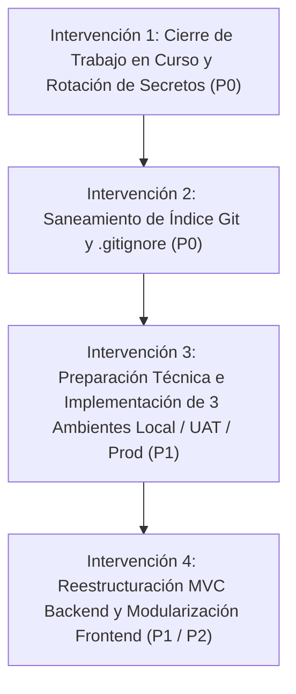

# 13 — Plan de Trabajo Siguiente (Hoja de Ruta Post-Auditoría)

## 1. Decisiones Agrupadas que Requieren Autorización Humana

Antes de iniciar las siguientes fases operativas, la dirección técnica debe autorizar las siguientes 4 decisiones:

1. **Rotación de Credenciales Expuestas (Urgente — Seguridad P0)**:
   - Autorizar la rotación de la contraseña del rol PostgreSQL en **Neon Cloud** (cuya URL estuvo presente en `backend/.env` local y en los 3 scripts locales eliminados en el Lote 4).
   - Autorizar la rotación de contraseñas de las cuentas de base de datos local y usuarios de prueba (`supervisor_extrusion`, `supervisor_extrusion_e2e`, `admin_alm`, `admin_extrusion`, `nexus`, `admin`) expuestas en los 9 archivos `.codex-e2e-*.cjs` y en `backend/scripts/migrate-master-data.js`, `create_admin_extrusion.js` y `set_pwd.js`.
2. **Confirmación de Regla de Negocio en Telares (`GLOBO` en `ROLLO_TELA`)**:
   - Confirmar si la modificación activa en `backend/src/modules/telares/productionRules.js` (que vuelve a permitir la etapa `GLOBO` en rutas de `ROLLO_TELA`) es la regla definitiva del cliente, para actualizar en consonancia los 3 tests unitarios en `backend/test/telares.production-rules.test.js` y `backend/test/telares.rules.test.js`.
3. **Aprobación del Commit de Saneamiento de Git (`09_SANEAMIENTO_GITHUB.md`)**:
   - Autorizar la ejecución de `git rm` / `git rm --cached` sobre los archivos en revisión clasificados en [`05_ARCHIVOS_EN_REVISION.md`](./05_ARCHIVOS_EN_REVISION.md) (las 6 migraciones duplicadas en `backend/src/database/legacy/`, los 21 scripts `.codex-e2e-*.cjs`, el archivo `frontend/vite.config.js.timestamp-*.mjs`, las capturas `tmp/pdfs/*.png` y `.audit-telares/*.png`, y el des-rastreo de `backend/error_log.txt`, `error_log.txt`, `backend/validation_error.txt` y `backend/master_data_dump.sql`).
4. **Confirmación de Retiro de Módulos Huérfanos Legados**:
   - Autorizar la eliminación en la fase de reestructuración MVC de los módulos backend no montados (`backend/src/modules/intermediate/`, `processes/`, `scrap/` legado, `catalogs/storageLocation*`) y de los archivos DDD huérfanos con imports rotos en `frontend/src/modules/{identity,production,warehouse}/{domain,application,infrastructure}`.

---

## 2. Secuencia Recomendada de Intervenciones Posteriores

### Intervención 1 — Cierre de Trabajo en Curso y Rotación de Secretos (Duración estimada: 1 sesión)
- **Objetivo**: Dejar el árbol de trabajo de `main` completamente limpio (`git status` sin modificaciones pendientes) y con el 100 % de las pruebas unitarias en verde.
- **Tareas**:
  1. Alinear las 3 aserciones de `telares.production-rules.test.js` y `telares.rules.test.js` con la regla vigente de `productionRules.js`.
  2. Hacer commit de los `74` archivos funcionales modificados (`M`) y los `19` archivos funcionales nuevos (`??`).
  3. Rotar credenciales de Neon Cloud y usuarios demo/operativos; limpiar `DATABASE_URL` y `REMOTE_DATABASE_URL` del archivo `backend/.env` de desarrollo local.
- **Criterio de salida**: `node --test` con `0` fallos (`75/75` unitarios aprobados) y `git status` sin cambios funcionales sin confirmar.

### Intervención 2 — Saneamiento de Git y GitHub (Duración estimada: 1 sesión)
- **Objetivo**: Ejecutar la guía exacta de la Sección 6 de [`09_SANEAMIENTO_GITHUB.md`](./09_SANEAMIENTO_GITHUB.md).
- **Tareas**:
  1. Eliminar `fs.appendFileSync('error_log.txt')` de `backend/src/middlewares/error.middleware.js` y `fs.writeFileSync('validation_error.txt')` de `backend/src/middlewares/validation.middleware.js`.
  2. Ejecutar `git rm --cached` sobre logs y dumps SQL (`backend/error_log.txt`, `backend/master_data_dump.sql`, `backend/validation_error.txt`, `backend/test-label.pdf`).
  3. Ejecutar `git rm` sobre `backend/src/database/legacy/`, `.codex-e2e-*.cjs`, `frontend/vite.config.js.timestamp-*.mjs`, `tmp/pdfs/`, `.audit-telares/` y los scripts obsoletos en `backend/`.
  4. Actualizar `.gitignore` y verificar que `npm run build`, `npx vitest run` y `node --test` pasen sin regresiones.
- **Criterio de salida**: Repositorio libre de logs rastreados, dumps SQL, artefactos temporales y scripts con contraseñas.

### Intervención 3 — Implementación de los 3 Ambientes: Local, UAT y Producción (Duración estimada: 1 a 2 sesiones)
- **Objetivo**: Implementar el diseño de [`10_ESTRATEGIA_DE_AMBIENTES.md`](./10_ESTRATEGIA_DE_AMBIENTES.md).
- **Tareas**:
  1. Actualizar `backend/src/config/env.js`, `database.js` y `sequelize-cli.config.js` para soportar explícitamente `development`, `test`, `uat` y `production` con guardas contra escritura cruzada.
  2. Corregir `frontend/.env.example` (`VITE_API_URL=http://localhost:4000/api`) y configurar el manejo de URL de API por ambiente.
  3. Crear la rama `uat` y configurar en GitHub los Environments `uat` (despliegue automático desde `uat`) y `production` (con **Required Reviewers** desde `main`).
  4. Parametrizar `.github/workflows/migrations.yml` y `rollback.yml` para operar por ambiente sin exponer Producción a pushes directos sin paso previo por UAT.
- **Criterio de salida**: Despliegue y migración verificados en UAT de forma completamente aislada de Producción.

### Intervención 4 — Reestructuración MVC Backend y Modularización Frontend (Duración estimada: 3 a 5 sesiones incrementales)
- **Objetivo**: Ejecutar las 5 etapas del plan incremental de [`08_PROPUESTA_REESTRUCTURACION.md`](./08_PROPUESTA_REESTRUCTURACION.md).
- **Tareas**:
  1. **Etapa 4.1**: Retirar los 46 archivos huérfanos de `backend/src/` y los 82 archivos huérfanos de `frontend/src/`, logrando que `tsc --noEmit` pase con `0` errores en todo el frontend.
  2. **Etapa 4.2**: Extraer `ExtrusionProductionAdjustment` y modularizar las asociaciones de `backend/src/database/models/index.js`.
  3. **Etapa 4.3**: Descomponer `extrusion.service.js` (8,303 líneas), `traceability.service.js` (3,629 líneas) y `telares.service.js` (2,846 líneas) en sub-servicios cohesivos conservando fachadas y 100 % de compatibilidad con pruebas.
  4. **Etapa 4.4**: Mover las consultas Sequelize de los 18 controladores identificados en `07_AUDITORIA_MVC.md` a sus servicios y unificar `apiResponse.js`.
  5. **Etapa 4.5**: Dividir los 10 componentes de frontend >1,000 líneas (`MixingTerminalForm.tsx`, `TelaresCatalogPage.tsx`, `PtiIngressPresenter.tsx`, `TelaresTerminalPage.tsx`, etc.) e implementar `React.lazy()` en `frontend/src/app/router.jsx` para reducir el bundle inicial de `3.71 MB` a chunks por dominio de `<500 KB`.
