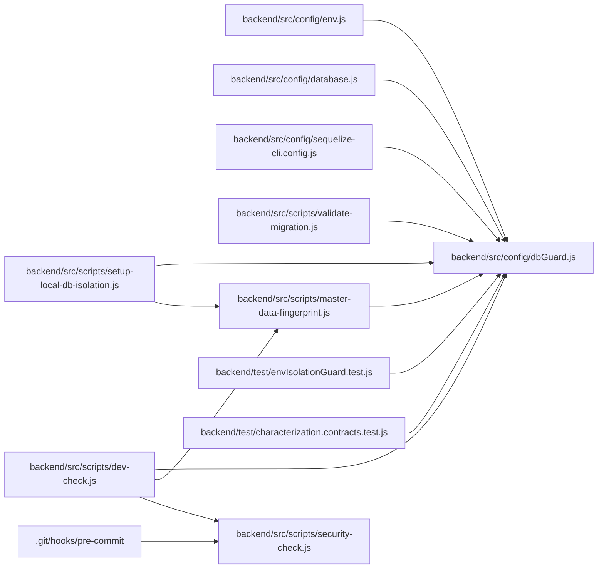

# 09 — Mapa de Dependencias Verificado (Fase 7)

## 1. Referencia Cruzada con la Auditoría Estructural

El grafo completo de dependencias estáticas y dinámicas (`require`, `import`, alias de Vite/TypeScript, rutas Express, registro de 77 modelos Sequelize, workflows CI/CD, 59 imports no resueltos y 128 archivos sin referencias entrantes) se encuentra documentado en [`docs/audit/03_MAPA_DE_DEPENDENCIAS.md`](file:///c:/Users/maicr/OneDrive/Desktop/Demo/docs/audit/03_MAPA_DE_DEPENDENCIAS.md).

Este documento amplía dicho análisis incorporando:
1. **Las nuevas dependencias de seguridad y aislamiento** introducidas durante la intervención de preparación (`dbGuard.js`, `security-check.js`, `master-data-fingerprint.js`, `setup-local-db-isolation.js`, `dev-check.js`).
2. **La verificación de archivos cargados por convención, CLI, migraciones o scripts** para garantizar que ningún archivo necesario sea clasificado erróneamente como huérfano.
3. **La matriz de acoplamiento inter-modular en Backend** que guía el orden de la futura reestructuración MVC.

---

## 2. Grafo de las Nuevas Guardas de Seguridad y Herramientas de Preparación

---

## 3. Verificación de Archivos sin Imports Directos pero Cargados por Convención o CLI

Tal como exige la Fase 7 (*"No declares huérfano un archivo solamente por no encontrar imports directos. Investiga imports dinámicos, aliases, cargas por convención, ejecución CLI y configuraciones externas"*), se verificaron los siguientes conjuntos de archivos que no tienen `require()` estático desde `server.js` pero **SÍ son utilizados activamente por herramientas o convenciones**:

| Conjunto de Archivos | Cantidad | Mecanismo de Carga Real | Clasificación Correcta |
|---|---:|---|---|
| `backend/src/database/migrations/*.js` | 88 | Cargados dinámicamente por `sequelize-cli db:migrate` según la ruta configurada en `backend/.sequelizerc` (`migrations-path`). | **CRÍTICO (Conservar 100 %)** |
| `backend/src/database/seeders/*.js` | 8 | Cargados dinámicamente por `sequelize-cli db:seed` según `backend/.sequelizerc` (`seeders-path`). | **CRÍTICO (Conservar 100 %)** |
| `backend/src/config/sequelize-cli.config.js` | 1 | Cargado por `sequelize-cli` a través de `backend/.sequelizerc` (`config`). | **CONFIGURACIÓN CRÍTICA (Conservar)** |
| `backend/src/scripts/validate-migration.js`, `provision-demo-users.js`, `verify-catalog-seed.js` | 3 | Ejecutados por CLI desde `.github/workflows/migrations.yml`, `provision-demo-users.yml` y `seed-catalogs.yml`. | **CRÍTICO CI/CD (Conservar)** |
| `backend/src/scripts/security-check.js`, `master-data-fingerprint.js`, `setup-local-db-isolation.js`, `dev-check.js` | 4 | Ejecutados por scripts de `package.json` (`dev:check`, `security:check`, `test:integrity`, `db:backup:local`), `.git/hooks/pre-commit` y `.github/workflows/migrations.yml`. | **CRÍTICO DEVSECOPS (Conservar)** |
| `frontend/src/testing/setup.js`, `frontend/src/testing/harness/*` | 3 | Cargados por `frontend/vitest.config.js` (`setupFiles: ['./src/testing/setup.js']`) y por las suites de contrato/integración de Vitest. | **PRUEBA ACTIVA (Conservar)** |

---

## 4. Acoplamiento Inter-Modular en `backend/src/modules/`

El análisis de dependencias cruzadas entre los módulos productivos de `backend/src/modules/` demuestra que:

1. **Núcleo de Persistencia Compartido (`backend/src/database/models/index.js`)**:
   - Es consumido directamente por **37 archivos** en `backend/src/modules/`.
   - **No existen ciclos circulares (`0` ciclos)** porque los archivos `*.model.js` exportan funciones de fábrica `(sequelize, DataTypes) => Model` que no importan servicios, y los servicios importan el objeto agregador `database/models/index.js`.
2. **Servicios Compartidos Transversalmente**:
   - `backend/src/modules/traceability/traceabilityDomain.service.js`: Consumido por `reception`, `warehouse` y `extrusion`.
   - `backend/src/modules/warehouse/inventoryDomain.service.js`: Consumido por `reception`, `warehouse` y `ptiWarehouseTransfer.service.js`.
   - `backend/src/modules/wip/rollTransformation.js`, `specificationCatalog.js` y `telaresScrapObservation.service.js`: Consumidos conjuntamente por `laminado`, `globo`, `corte` y `telares`.
   - `backend/src/modules/materials/materialEquivalence.js` y `backend/src/modules/warehouse/consumptionPackageAllocator.js`: Consumidos conjuntamente por `warehouse/consumptionOrder.service.js` y `extrusion/extrusion.service.js`.
3. **Implicación para la Reestructuración MVC**:
   - Estos 6 módulos transversales (`traceabilityDomain.service.js`, `inventoryDomain.service.js`, `rollTransformation.js`, `specificationCatalog.js`, `materialEquivalence.js`, `consumptionPackageAllocator.js`) poseen contratos estables y pruebas unitarias/integración directas; durante la descomposición de los servicios monolíticos deben mantenerse como servicios de dominio compartidos sin duplicar su lógica.
