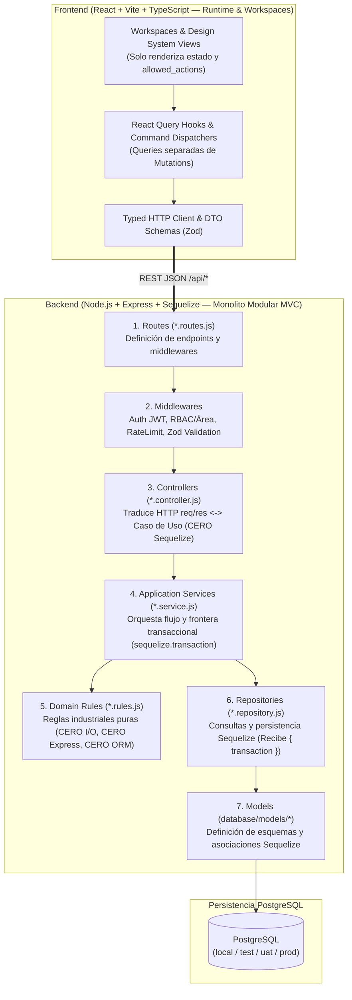

# 10 — ARQUITECTURA OBJETIVO MVC MODULAR Y ESTÁNDARES DE INGENIERÍA

**Proyecto:** TraceFlow MES — INTERPLAS México  
**Fecha:** 2026-11-25  
**Fase:** Fase 8 — Diseño Objetivo MVC y Convenciones Obligatorias

---

## 1. Definición del Patrón Arquitectónico Objetivo

Para TraceFlow MES se establece formalmente una arquitectura de **Monolito Modular con Patrón MVC + Capa de Servicios de Aplicación + Reglas de Dominio Puras + Repositorios de Acceso a Datos** en el Backend, acoplada a una arquitectura **Feature-Based Runtime MVC / Workspaces** en el Frontend (en estricto cumplimiento de las 20 Reglas de Oro de `AGENTS.md`).

### 1.1 Por qué este patrón es el adecuado para TraceFlow MES
1. **Integridad Transaccional Industrial:** Los procesos MES (Almacén -> Mezcla -> Extrusión -> Telares -> Laminado -> Corte -> Liner/Globo) requieren transacciones ACID que abarcan inventario, WIP, genealogía de lotes, custodia y trazabilidad QR en una misma base de datos PostgreSQL. Un monolito modular conserva transacciones locales ACID sin la complejidad ni latencia de transacciones distribuidas.
2. **Separación Estricta de Responsabilidades (SoC):** Elimina los dos problemas estructurales detectados en la auditoría (`18` controladores con acceso directo a Sequelize y `4` servicios monolíticos de hasta `8,303` líneas).
3. **Testabilidad Unitaria sin Base de Datos:** Al extraer las fórmulas industriales, validaciones de ruta, redondeo por presentación y reglas de transformación a **Reglas de Dominio Puras (`rules/`)**, se pueden probar unitariamente en milisegundos sin conexión a PostgreSQL.

---

## 2. Diagrama de Capas y Flujo de Dependencias



---

## 3. Estructura de Directorios Objetivo

### 3.1 Estructura Objetivo del Backend (`backend/src/`)

```text
backend/src/
├── app.js                              # Configuración Express, middlewares globales y montaje de rutas
├── server.js                           # Bootstrap HTTP, verificación dbGuard y graceful shutdown
├── config/
│   ├── dbGuard.js                      # Guarda fail-closed de aislamiento por APP_ENV
│   ├── env.js                          # Validación y carga tipada de variables de entorno
│   ├── database.js                     # Instancia Sequelize protegida por dbGuard
│   └── sequelize-cli.config.js         # Configuración CLI protegida por dbGuard
├── database/
│   ├── models/
│   │   ├── index.js                    # Fachada central retrocompatible (exporta los 77 modelos)
│   │   ├── associations/               # Asociaciones divididas por dominio industrial
│   │   │   ├── catalog.associations.js
│   │   │   ├── warehouse.associations.js
│   │   │   ├── extrusion.associations.js
│   │   │   ├── telares.associations.js
│   │   │   ├── laminado.associations.js
│   │   │   ├── corte.associations.js
│   │   │   ├── liner.associations.js
│   │   │   └── traceability.associations.js
│   │   └── ...                         # Archivos *.model.js individuales
│   ├── migrations/                     # Migraciones secuenciales inmutables
│   └── seeders/                        # Seeders clasificados por entorno (catalog vs demo-uat)
├── shared/
│   ├── errors/
│   │   ├── AppError.js                 # Clase base de error operacional con statusCode y errorCode
│   │   └── errorCodes.js               # Catálogo estandarizado de códigos de error MES
│   ├── http/
│   │   ├── apiResponse.js              # Helpers estandarizados de respuesta HTTP
│   │   └── asyncHandler.js             # Wrapper para captura automática de promesas en controladores
│   ├── middlewares/
│   │   ├── auth.middleware.js          # Verificación JWT y contexto de usuario/área
│   │   ├── validate.middleware.js      # Validación declarativa de req.body/query/params
│   │   └── error.middleware.js         # Manejador centralizado de errores Express
│   └── security/
│       └── qrCrypto.js                 # Cifrado y firma AES-256-GCM de códigos QR
└── modules/
    ├── auth/
    ├── catalogs/
    ├── warehouse/
    ├── mezcla/
    ├── extrusion/
    ├── telares/
    ├── laminado/
    ├── corte/
    ├── liner/
    ├── quality/
    ├── traceability/
    └── dashboard/
        ├── <module>.routes.js          # Definición de rutas Express
        ├── controllers/                # Controladores HTTP delgados (sin Sequelize)
        ├── services/                   # Servicios de aplicación cohesivos (< 500 líneas c/u)
        ├── repositories/               # Consultas y mutaciones Sequelize encapsuladas
        ├── rules/                      # Funciones puras de reglas industriales y cálculos
        ├── validators/                 # Esquemas de validación de entrada
        └── dto/                        # Transformadores y contratos de salida (incluyendo allowed_actions)
```

### 3.2 Estructura Objetivo del Frontend (`frontend/src/`)

```text
frontend/src/
├── app/                                # Bootstrap React, Providers (QueryClient, Theme, Auth, ErrorBoundary)
├── runtime/                            # Capability Registry, Workflow Engine, QR/Universal Search Router
├── shared/
│   ├── ui/                             # Componentes Shadcn/UI del Design System Industrial (con contratos)
│   ├── api/                            # Cliente HTTP centralizado e interceptores
│   └── utils/                          # Formateadores visuales (fechas, etiquetas; CERO cálculos de negocio)
└── modules/
    ├── auth/
    ├── warehouse/
    ├── extrusion/
    ├── telares/
    ├── laminado/
    ├── corte/
    ├── liner/
    ├── traceability/
    └── dashboard/
        ├── pages/                      # Workspaces consumidores del Runtime (Golden Rule #20)
        ├── components/                 # Componentes presentacionales del dominio
        ├── hooks/                      # Custom hooks con separación estricta Queries vs Mutations
        ├── services/                   # Clientes de API tipados del módulo
        ├── schemas/                    # Esquemas Zod de validación de formularios (React Hook Form)
        └── types/                      # Contratos TypeScript alineados con DTOs del backend
```

---

## 4. Responsabilidades y Prohibiciones Estrictas por Capa

| Capa | Responsabilidad Exclusiva | Prohibiciones Absolutas (Lo que NO debe hacer) |
| :--- | :--- | :--- |
| **1. Routes (`*.routes.js`)** | Declarar verbos HTTP, paths, middlewares de autenticación/autorización, validación de esquema y delegar al método del controlador. | Prohibido contener lógica condicional, consultas a BD o manipulación de `req`/`res`. |
| **2. Controllers (`*.controller.js`)** | Extraer datos validados de `req.params`, `req.query`, `req.body` y `req.user`; invocar **un** método de Application Service; devolver la respuesta HTTP con el código de estado adecuado. | **PROHIBIDO importar `database/models`, `sequelize` o `Op`.** Prohibido abrir transacciones o ejecutar cálculos industriales. |
| **3. Application Services (`*.service.js`)** | Orquestar casos de uso completos, abrir y confirmar/revertir transacciones (`sequelize.transaction`), coordinar repositorios, invocar reglas de dominio puras y construir el DTO de respuesta (incluyendo `allowed_actions`). | Prohibido conocer objetos HTTP (`req`, `res`, `next`). Prohibido superar `500–600` líneas por archivo (debe dividirse por sub-caso de uso). |
| **4. Domain Rules (`*.rules.js`)** | Ejecutar validaciones de negocio puras, fórmulas de peso/rendimiento/merma, máquinas de estado, rutas permitidas y cálculo de `allowed_actions`. | **PROHIBIDO realizar I/O**, consultas a base de datos, llamadas de red o lecturas de `process.env`. Deben ser funciones 100% deterministas. |
| **5. Repositories (`*.repository.js`)** | Encapsular consultas complejas Sequelize (`findAll`, `findOne`, `create`, `update`, `LOCK.UPDATE`), aceptando siempre el parámetro opcional `{ transaction }`. | Prohibido tomar decisiones de flujo de negocio o abrir transacciones propias sin recibir el contexto transaccional del servicio. |
| **6. Frontend Workspaces & Components** | Visualizar el estado devuelto por el backend, renderizar botones gobernados exclusivamente por `allowed_actions` y despachar comandos/mutaciones vía React Query. | **PROHIBIDO calcular cantidades, balances, OEE, scrap o porcentajes en el cliente** (Golden Rules #1, #2, #3, #6, #13). |

---

## 5. Convenciones Obligatorias de Código

1. **Nomenclatura de Archivos:**
   - Backend: `<dominio>.<subdominio>.<capa>.js` en `camelCase` o `kebab-case` consistente con el módulo (ej. `extrusionRun.service.js`, `extrusionRun.repository.js`, `extrusion.rules.js`).
   - Frontend: Componentes React en `PascalCase.tsx`; hooks en `use<Nombre>.ts`; servicios API en `<dominio>.api.ts`; esquemas Zod en `<dominio>.schema.ts`.
2. **Exportaciones e Importaciones:**
   - Durante la transición incremental, todo módulo refactorizado **debe mantener una fachada de re-exportación idéntica** en su archivo original (ej. `extrusion.service.js`) para no romper ningún consumidor existente.
   - Prohibido introducir dependencias circulares entre módulos. La comunicación entre módulos hermanos debe realizarse a través de sus servicios públicos o eventos de aplicación, nunca importando repositorios internos de otro módulo.
3. **Manejo de Errores:**
   - Los servicios y reglas de dominio deben lanzar instancias de `AppError` (o errores con propiedades `{ code, statusCode, message, details }`) y **nunca** devolver respuestas HTTP directas.
   - El middleware central de errores traduce `AppError` al contrato JSON esperado por el frontend sin exponer stack traces ni detalles SQL en `uat` o `production`.
4. **Fronteras Transaccionales (`Transaction Boundaries`):**
   - Toda operación que modifique más de un registro (ej. consumir lote + crear movimiento de inventario + actualizar WIP + registrar evento de trazabilidad) **debe ejecutarse dentro de una única transacción `sequelize.transaction(...)`** iniciada en el Application Service principal.
   - Todo método auxiliar o de repositorio invocado dentro de ese flujo **debe recibir y propagar `{ transaction }`**. Está estrictamente prohibido hacer queries fuera de la transacción activa cuando se lee o modifica estado relacionado.
5. **Contratos HTTP y Retrocompatibilidad:**
   - Ninguna refactorización interna puede cambiar nombres de campos JSON, códigos HTTP ni estructura de respuesta consumida por el frontend o por las pruebas de caracterización (`characterization.contracts.test.js`).
6. **Logging Seguro:**
   - Prohibido imprimir en consola o logs valores de `JWT_SECRET`, `QR_HMAC_KEY`, `DB_PASS`, `DATABASE_URL`, tokens `Bearer` o contraseñas en texto plano.
