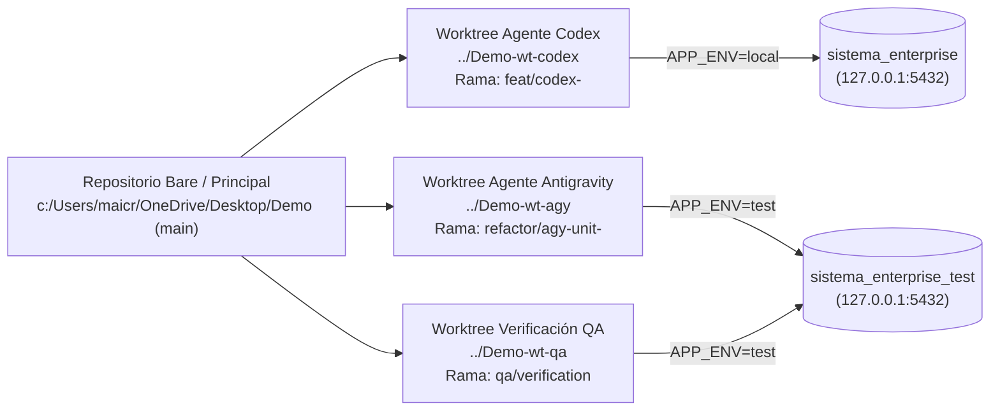

# 12 — PROTECCIÓN DE TRABAJO CONCURRENTE Y PROTOCOLO DE COORDINACIÓN MULTI-AGENTE (FASE K)

**Proyecto:** TraceFlow MES — INTERPLAS México  
**Fecha:** 2026-11-25  
**Agentes Concurrentes Detectados en el Espacio de Trabajo:** `Codex` y `Antigravity`

---

## 1. Detección Forense de Actividad Concurrente Durante la Intervención

Antes de ejecutar cualquier operación de limpieza en esta Fase de Cierre, se ejecutó un análisis de marcas de tiempo (`mtime`) y comparación triple de hashes SHA-256 (`Snapshot 0` $\rightarrow$ `Snapshot 1` $\rightarrow$ `Snapshot 2`) sobre todo el árbol de trabajo.

Este control permitió detectar que el agente **Codex** intervino concurrentemente sobre dos grupos de archivos mientras el espacio de trabajo estaba activo:

### 1.1 Ventana Concurrente 1 (`03:12Z` – `04:06Z` / `21:12` – `22:06` hora local): Resolución de `QA-EXT-HANDOFF-001` por Codex
Archivos modificados por **Codex** para habilitar el relevo digital de mezclas activas entre turnos en Extrusión:
1. `frontend/src/modules/extrusion/services/extrusionApi.ts` (`03:12:40Z`, `SHA-256: 9edff3c0...`)
2. `backend/test/extrusionShiftHandoff.local.integration.test.js` (`03:12:49Z`, `SHA-256: dc2d4788...`)
3. `docs/qa/MULTIRUN_REPORT.md` (`03:13:27Z`)
4. `frontend/src/modules/extrusion/presentation/pages/ExtrusionShiftPage.tsx` (`03:17:33Z`, `SHA-256: a7f3077e...`)
5. `docs/qa/DEFECT_REGISTER.md` (`04:01:33Z`)
6. `docs/qa/QA_MASTER_REPORT.md` (`04:01:46Z`)
7. `backend/src/modules/extrusion/services/shiftPolicy.js` (`04:04:47Z`, `SHA-256: c00c259e...`)
8. `backend/src/modules/extrusion/extrusion.service.js` (`04:04:59Z`, `SHA-256: 2d2c5020...`)
9. `frontend/src/modules/extrusion/presentation/presenters/ExtrusionShiftSessionPanel.tsx` (`04:05:12Z`, `SHA-256: 48ce8628...`)
10. `backend/src/modules/extrusion/services/shiftPolicy.test.js` (`04:06:13Z`, `SHA-256: 5d562901...`)

### 1.2 Ventana Concurrente 2 (`05:06Z` – `05:16Z` / `23:06` – `23:16` hora local): Endurecimiento Adicional de Guardas por Codex
Archivos modificados por **Codex** inmediatamente antes del inicio de esta Fase de Cierre:
1. `backend/src/config/dbGuard.js` (`05:06:48Z` — adición de `assertSequelizeCliProfile`)
2. `backend/src/config/sequelize-cli.config.js` (`05:07:01Z` — integración de `assertSequelizeCliProfile`)
3. `backend/test/envIsolationGuard.test.js` (`05:07:25Z` — noveno caso de prueba para `assertSequelizeCliProfile`)
4. `backend/scripts/migrate-master-data.js` (`05:09:32Z` — bloqueo `MASTER_DATA_REMOTE_MIGRATION_DISABLED`)
5. `backend/scripts/masterdata-neon/inspect.js` (`05:09:37Z` — bloqueo `REMOTE_MASTER_DATA_INSPECTION_DISABLED`)
6. `backend/scripts/seed-manual-entry-permission.js` (`05:09:49Z` — bloqueo `UNCONTROLLED_MASTER_DATA_SEED_DISABLED`)
7. `backend/src/scripts/security-check.js` (`05:16:06Z` — adición de regla `TRACKED_SENSITIVE_ARTIFACT` sobre `git ls-files`)

### 1.3 Acción de Protección Aplicada por Antigravity en esta Fase de Cierre
- **100% de las modificaciones de Codex fueron respetadas y conservadas intactas.**
- Ninguno de los archivos tocados por Codex en las Ventanas 1 o 2 fue revertido, sobrescrito ni eliminado durante la limpieza física de la Fase F.
- Los 3 scripts en `backend/scripts/` que Codex bloqueó a las `05:09Z` (`migrate-master-data.js`, `masterdata-neon/inspect.js`, `seed-manual-entry-permission.js`) fueron excluidos de la eliminación física y conservados en `FILES_PENDING_REVIEW.md` para no interferir con la validación de Codex.

---

## 2. Propuesta de Coordinación Multi-Agente (Git Worktrees y Delimitación de Módulos)

*(Nota: Conforme a las instrucciones de la Fase K, esta estrategia se presenta como propuesta arquitectónica de proceso y **no ha sido implementada todavía**).*

### 2.1 Diagnóstico del Riesgo Actual
Actualmente, tanto desarrolladores humanos como múltiples agentes de IA (`Codex`, `Antigravity`) operan simultáneamente sobre **un único árbol de trabajo compartido** (`c:\Users\maicr\OneDrive\Desktop\Demo` en la rama `main`) y comparten la misma base de datos de desarrollo (`sistema_enterprise`). Esto genera tres riesgos:
1. Colisión de ediciones sobre archivos monolíticos compartidos (`extrusion.service.js`, `telares.service.js`, `database/models/index.js`).
2. Contaminación de `git status` y `git diff` cuando un agente ejecuta validaciones mientras otro edita.
3. Efectos laterales en archivos generados en tiempo de ejecución (`backend/error_log.txt`, `backend/validation_error.txt`).

### 2.2 Arquitectura Propuesta de Aislamiento con `git worktree`

### 2.3 Reglas Operativas del Protocolo Propuesto

1. **Un Worktree y una Rama por Agente / Unidad de Trabajo:**
   - Antes de iniciar una sesión paralela, crear un worktree dedicado fuera del árbol principal:
     - `git worktree add ../Demo-wt-agy -b refactor/mvc-unit-1`
     - `git worktree add ../Demo-wt-codex -b fix/extrusion-handoff`
   - Esto garantiza aislamiento total a nivel de sistema de archivos sin duplicar el directorio `.git/`.
2. **Bloqueo por Dominio / Unidad de Refactorización (Ownership Matrix):**
   - Mientras un agente ejecuta una **Unidad de Refactorización MVC** (ej. Unidad 1: Controladores de Catálogos/Dashboard), ningún otro agente debe modificar archivos dentro de ese mismo módulo (`backend/src/modules/<dominio>/`).
   - Los archivos transversales compartidos (`backend/src/database/models/index.js`, `backend/src/routes/index.js`, `package.json`, `AGENTS.md`) solo pueden ser modificados por **un agente a la vez** bajo ventana exclusiva.
3. **Separación de Bases de Datos por Rol de Agente:**
   - Las pruebas automatizadas de regresión y caracterización (`node:test`) de cualquier agente deben ejecutarse siempre con `APP_ENV=test` contra `sistema_enterprise_test` (usando transacciones con rollback).
4. **Revisión Humana Obligatoria antes de Merge a `main`:**
   - Ningún agente realiza `git merge` directo a `main` ni `git push`.
   - Cada worktree debe pasar `npm run validate` y `npm --prefix backend run db:verify:local` en su propia rama antes de que el ingeniero responsable revise el diff y autorice su integración.
